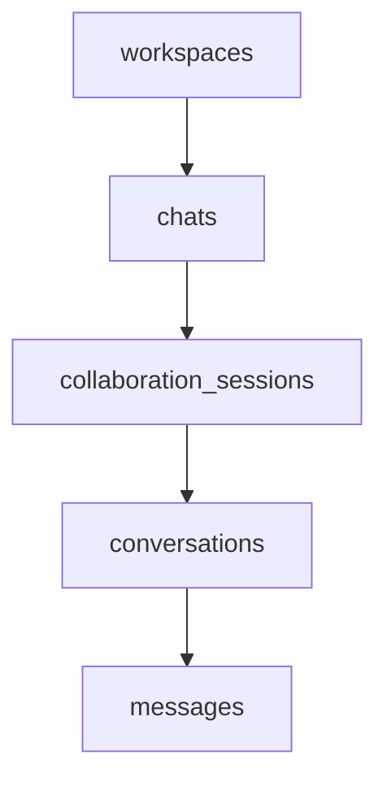

# 核心表强类型迁移指南（你的任务）

## 任务概览

你负责将以下 **5 个核心表**从 `i64` 迁移到强类型 ID：

| 表名 | 主键类型 | 外键 | 预估工作量 |
|------|----------|------|------------|
| `conversations` | `ConversationId` | `ChatId`, `SessionId` | 2-3 小时 |
| `messages` | `MessageId` | `ConversationId` | 1-2 小时 |
| `workspaces` | `WorkspaceId` | `ProjectId` | 1-2 小时 |
| `chats` | `ChatId` | `WorkspaceId` | 1-2 小时 |
| `collaboration_sessions` | `SessionId` | `ChatId`, `WorkspaceId` | 2-3 小时 |

**总工作量：** 7-12 小时

---

## 迁移顺序

建议按以下顺序迁移（考虑依赖关系）：



1. **workspaces** - 无依赖
2. **chats** - 依赖 workspaces
3. **collaboration_sessions** - 依赖 chats, workspaces
4. **conversations** - 依赖 collaboration_sessions, chats
5. **messages** - 依赖 conversations

---

## 详细改动指南

### 1. workspaces 表

#### 1.1 数据库结构体

**文件：** `crates/ergatai-api/src/user_data_db.rs`

**位置：** `workspaces` 模块

```rust
// ===== 修改前 =====
pub struct Workspace {
    pub workspace_id: i64,
    pub name: String,
    pub work_dir: String,
    pub default_project_id: Option<i64>,
    pub created_at: i64,
    pub updated_at: i64,
}

// ===== 修改后 =====
use ergatai_error::{WorkspaceId, ProjectId};

pub struct Workspace {
    pub workspace_id: WorkspaceId,           // ❌ 改为 WorkspaceId
    pub name: String,
    pub work_dir: String,
    pub default_project_id: Option<ProjectId>, // ❌ 改为 Option<ProjectId>
    pub created_at: i64,
    pub updated_at: i64,
}
```

#### 1.2 CRUD 函数

**文件：** `crates/ergatai-api/src/user_data_db.rs`

```rust
// ===== 修改前 =====
pub fn get(workspace_id: i64) -> Result<Option<Workspace>> {
    let conn = get_connection()?;
    let mut stmt = conn.prepare("SELECT ... WHERE workspace_id = ?1")?;
    stmt.query_row(params![workspace_id], ...)?;
}

pub fn create(mut workspace: Workspace) -> Result<Workspace> {
    workspace.workspace_id = generate();
    let conn = get_connection()?;
    conn.execute(
        "INSERT INTO workspaces (workspace_id, ...) VALUES (?1, ...)",
        params![workspace.workspace_id, ...],
    )?;
    Ok(workspace)
}

pub fn update(workspace: Workspace) -> Result<()> {
    let conn = get_connection()?;
    conn.execute(
        "UPDATE workspaces SET ... WHERE workspace_id = ?1",
        params![..., workspace.workspace_id],
    )?;
    Ok(())
}

pub fn delete(workspace_id: i64) -> Result<bool> {
    let conn = get_connection()?;
    let affected = conn.execute("DELETE FROM workspaces WHERE workspace_id = ?1", params![workspace_id])?;
    Ok(affected > 0)
}

// ===== 修改后 =====
use ergatai_error::WorkspaceId;

pub fn get(workspace_id: WorkspaceId) -> Result<Option<Workspace>> {
    let conn = get_connection()?;
    let mut stmt = conn.prepare("SELECT ... WHERE workspace_id = ?1")?;
    stmt.query_row(params![workspace_id], ...)?;  // ✅ 直接传 WorkspaceId
}

pub fn create(mut workspace: Workspace) -> Result<Workspace> {
    workspace.workspace_id = WorkspaceId::generate();  // ✅ 使用 generate()
    let conn = get_connection()?;
    conn.execute(
        "INSERT INTO workspaces (workspace_id, ...) VALUES (?1, ...)",
        params![workspace.workspace_id, ...],  // ✅ 直接传
    )?;
    Ok(workspace)
}

pub fn update(workspace: Workspace) -> Result<()> {
    let conn = get_connection()?;
    conn.execute(
        "UPDATE workspaces SET ... WHERE workspace_id = ?1",
        params![..., workspace.workspace_id],  // ✅ 直接传
    )?;
    Ok(())
}

pub fn delete(workspace_id: WorkspaceId) -> Result<bool> {
    let conn = get_connection()?;
    let affected = conn.execute(
        "DELETE FROM workspaces WHERE workspace_id = ?1",
        params![workspace_id]  // ✅ 直接传
    )?;
    Ok(affected > 0)
}
```

#### 1.3 Service 层

**文件：** `crates/ergatai-api/src/services/workspace_service.rs`

```rust
// ===== 修改前 =====
use crate::user_data_db::workspaces;

pub fn get_workspace(workspace_id: i64) -> anyhow::Result<Workspace> {
    workspaces::get(workspace_id)?
        .ok_or_else(|| anyhow::anyhow!("Workspace not found"))
}

pub fn list_workspaces() -> anyhow::Result<Vec<Workspace>> {
    workspaces::list()
}

pub fn create_workspace(mut workspace: Workspace) -> anyhow::Result<Workspace> {
    workspaces::create(workspace)
}

// ===== 修改后 =====
use ergatai_error::WorkspaceId;
use crate::user_data_db::workspaces;

pub fn get_workspace(workspace_id: WorkspaceId) -> anyhow::Result<Workspace> {
    workspaces::get(workspace_id)?
        .ok_or_else(|| anyhow::anyhow!("Workspace not found"))
}

pub fn list_workspaces() -> anyhow::Result<Vec<Workspace>> {
    workspaces::list()
}

pub fn create_workspace(mut workspace: Workspace) -> anyhow::Result<Workspace> {
    workspaces::create(workspace)
}
```

#### 1.4 API 层

**文件：** `crates/ergatai-api/src/api/workspaces.rs`

```rust
// ===== 修改前 =====
use ergatai_core::id::parse_to_i64;

async fn get_workspace(Path(id): Path<String>) -> impl IntoResponse {
    let id_i64 = parse_to_i64(&id)
        .ok_or_else(|| (StatusCode::BAD_REQUEST, "Invalid workspace ID"))?;
    
    let workspace = workspace_service::get_workspace(id_i64)
        .map_err(|e| (StatusCode::INTERNAL_SERVER_ERROR, e.to_string()))?;
    
    Json(format_workspace(workspace))
}

// ===== 修改后 =====
use ergatai_error::WorkspaceId;

async fn get_workspace(Path(id): Path<String>) -> impl IntoResponse {
    // ✅ 使用 parse() 直接解析为 WorkspaceId
    let id: WorkspaceId = id.parse()
        .map_err(|e| (StatusCode::BAD_REQUEST, format!("Invalid workspace ID: {}", e)))?;
    
    let workspace = workspace_service::get_workspace(id)
        .map_err(|e| (StatusCode::INTERNAL_SERVER_ERROR, e.to_string()))?;
    
    Json(workspace)  // ✅ Workspace 实现了 Serialize，自动序列化为字符串格式
}
```

#### 1.5 检查清单

- [ ] `Workspace` 结构体字段改为 `WorkspaceId` 和 `Option<ProjectId>`
- [ ] `workspaces::get()` 参数改为 `WorkspaceId`
- [ ] `workspaces::create()` 使用 `WorkspaceId::generate()`
- [ ] `workspaces::update()` 参数不变
- [ ] `workspaces::delete()` 参数改为 `WorkspaceId`
- [ ] `workspace_service` 函数签名更新
- [ ] API handler 使用 `.parse()` 解析
- [ ] 编译通过：`cargo check -p ergatai-api`
- [ ] 测试通过：`cargo test -p ergatai-api workspace`

---

### 2. chats 表

#### 2.1 数据库结构体

**文件：** `crates/ergatai-api/src/user_data_db.rs`

```rust
// ===== 修改前 =====
pub struct Chat {
    pub chat_id: i64,
    pub workspace_id: i64,
    pub name: String,
    pub created_at: i64,
    pub updated_at: i64,
}

// ===== 修改后 =====
use ergatai_error::{ChatId, WorkspaceId};

pub struct Chat {
    pub chat_id: ChatId,           // ❌ 改为 ChatId
    pub workspace_id: WorkspaceId, // ❌ 改为 WorkspaceId
    pub name: String,
    pub created_at: i64,
    pub updated_at: i64,
}
```

#### 2.2 CRUD 函数

**文件：** `crates/ergatai-api/src/user_data_db.rs`

```rust
// ===== 修改前 =====
pub fn get(chat_id: i64) -> Result<Option<Chat>> { ... }
pub fn list_by_workspace(workspace_id: i64) -> Result<Vec<Chat>> { ... }
pub fn create(mut chat: Chat) -> Result<Chat> {
    chat.chat_id = generate();
    ...
}

// ===== 修改后 =====
use ergatai_error::{ChatId, WorkspaceId};

pub fn get(chat_id: ChatId) -> Result<Option<Chat>> { ... }
pub fn list_by_workspace(workspace_id: WorkspaceId) -> Result<Vec<Chat>> { ... }
pub fn create(mut chat: Chat) -> Result<Chat> {
    chat.chat_id = ChatId::generate();  // ✅ 使用 ChatId::generate()
    ...
}
```

#### 2.3 Service 层

**文件：** `crates/ergatai-api/src/services/chat_service.rs`

```rust
// ===== 修改前 =====
pub fn get_chat(chat_id: i64) -> Result<Chat> { ... }
pub fn list_chats(workspace_id: Option<i64>) -> Result<Vec<Chat>> { ... }

// ===== 修改后 =====
use ergatai_error::{ChatId, WorkspaceId};

pub fn get_chat(chat_id: ChatId) -> Result<Chat> { ... }
pub fn list_chats(workspace_id: Option<WorkspaceId>) -> Result<Vec<Chat>> { ... }
```

#### 2.4 API 层

**文件：** `crates/ergatai-api/src/api/chats.rs`

```rust
// ===== 修改前 =====
async fn get_chat(Path(id): Path<String>) -> impl IntoResponse {
    let id_i64 = parse_to_i64(&id)?;
    let chat = chat_service::get_chat(id_i64)?;
    Json(format_chat(chat))
}

// ===== 修改后 =====
use ergatai_error::ChatId;

async fn get_chat(Path(id): Path<String>) -> impl IntoResponse {
    let id: ChatId = id.parse()?;
    let chat = chat_service::get_chat(id)?;
    Json(chat)  // ✅ 自动序列化
}
```

#### 2.5 检查清单

- [ ] `Chat` 结构体字段改为 `ChatId` 和 `WorkspaceId`
- [ ] `chats::get()` 参数改为 `ChatId`
- [ ] `chats::list_by_workspace()` 参数改为 `WorkspaceId`
- [ ] `chats::create()` 使用 `ChatId::generate()`
- [ ] `chat_service` 函数签名更新
- [ ] API handler 使用 `.parse()` 解析
- [ ] 编译通过
- [ ] 测试通过

---

### 3. collaboration_sessions 表

#### 3.1 数据库结构体

**文件：** `crates/ergatai-api/src/user_data_db.rs`

```rust
// ===== 修改前 =====
pub struct CollaborationSession {
    pub collaboration_session_id: i64,
    pub chat_id: i64,
    pub workspace_id: i64,
    pub mode: String,
    pub state: String,
    pub goal: Option<String>,
    pub active_plan_revision: Option<i64>,
    pub created_at: i64,
    pub updated_at: i64,
}

// ===== 修改后 =====
use ergatai_error::{CollaborationSessionId, ChatId, WorkspaceId};

pub struct CollaborationSession {
    pub collaboration_session_id: CollaborationSessionId, // ❌ 改为 CollaborationSessionId
    pub chat_id: ChatId,                                   // ❌ 改为 ChatId
    pub workspace_id: WorkspaceId,                         // ❌ 改为 WorkspaceId
    pub mode: String,
    pub state: String,
    pub goal: Option<String>,
    pub active_plan_revision: Option<i64>,  // ⚠️ 暂不改动（需要定义 RevisionId）
    pub created_at: i64,
    pub updated_at: i64,
}
```

#### 3.2 CRUD 函数

**文件：** `crates/ergatai-api/src/user_data_db.rs`

```rust
// ===== 修改后 =====
use ergatai_error::{CollaborationSessionId, ChatId, WorkspaceId};

pub fn get(session_id: CollaborationSessionId) -> Result<Option<CollaborationSession>> { ... }

pub fn list_by_chat(chat_id: ChatId) -> Result<Vec<CollaborationSession>> { ... }

pub fn list_by_workspace(workspace_id: WorkspaceId) -> Result<Vec<CollaborationSession>> { ... }

pub fn create(mut session: CollaborationSession) -> Result<CollaborationSession> {
    session.collaboration_session_id = CollaborationSessionId::generate();
    ...
}
```

#### 3.3 Service 层

**文件：** `crates/ergatai-api/src/services/collaboration_session.rs`

```rust
// ===== 修改后 =====
use ergatai_error::{CollaborationSessionId, ChatId, WorkspaceId};

pub fn get_session(session_id: CollaborationSessionId) -> Result<CollaborationSession> { ... }

pub fn list_sessions(
    chat_id: Option<ChatId>,
    workspace_id: Option<WorkspaceId>,
) -> Result<Vec<CollaborationSession>> { ... }

pub fn create_session(mut session: CollaborationSession) -> Result<CollaborationSession> { ... }
```

#### 3.4 API 层

**文件：** `crates/ergatai-api/src/api/collaboration_sessions.rs`

```rust
// ===== 修改后 =====
use ergatai_error::{CollaborationSessionId, ChatId, WorkspaceId};

async fn get_session(Path(id): Path<String>) -> impl IntoResponse {
    let id: CollaborationSessionId = id.parse()?;
    let session = collaboration_session_service::get_session(id)?;
    Json(session)
}
```

#### 3.5 检查清单

- [ ] `CollaborationSession` 结构体字段改为强类型
- [ ] CRUD 函数参数改为强类型
- [ ] Service 层函数签名更新
- [ ] API handler 使用 `.parse()` 解析
- [ ] 编译通过
- [ ] 测试通过

---

### 4. conversations 表

#### 4.1 数据库结构体

**文件：** `crates/ergatai-api/src/user_data_db.rs`

```rust
// ===== 修改前 =====
pub struct Conversation {
    pub conversation_id: i64,
    pub collaboration_session_id: i64,
    pub chat_id: i64,
    pub parent_id: Option<i64>,
    pub name: String,
    pub created_at: i64,
    pub updated_at: i64,
}

// ===== 修改后 =====
use ergatai_error::{ConversationId, CollaborationSessionId, ChatId};

pub struct Conversation {
    pub conversation_id: ConversationId,              // ❌ 改为 ConversationId
    pub collaboration_session_id: CollaborationSessionId, // ❌ 改为 CollaborationSessionId
    pub chat_id: ChatId,                               // ❌ 改为 ChatId
    pub parent_id: Option<ConversationId>,            // ❌ 改为 Option<ConversationId>
    pub name: String,
    pub created_at: i64,
    pub updated_at: i64,
}
```

#### 4.2 CRUD 函数

**文件：** `crates/ergatai-api/src/user_data_db.rs`

```rust
// ===== 修改后 =====
use ergatai_error::{ConversationId, CollaborationSessionId, ChatId};

pub fn get(conversation_id: ConversationId) -> Result<Option<Conversation>> { ... }

pub fn list_by_chat(chat_id: ChatId) -> Result<Vec<Conversation>> { ... }

pub fn list_by_session(session_id: CollaborationSessionId) -> Result<Vec<Conversation>> { ... }

pub fn create(mut conversation: Conversation) -> Result<Conversation> {
    conversation.conversation_id = ConversationId::generate();
    ...
}

pub fn update(conversation: Conversation) -> Result<()> { ... }

pub fn delete(conversation_id: ConversationId) -> Result<bool> { ... }
```

#### 4.3 Service 层

**文件：** `crates/ergatai-api/src/services/conversation_service.rs`

```rust
// ===== 修改后 =====
use ergatai_error::{ConversationId, ChatId, CollaborationSessionId};

pub fn get_conversation(conversation_id: ConversationId) -> Result<Conversation> { ... }

pub fn list_conversations(
    chat_id: Option<ChatId>,
    session_id: Option<CollaborationSessionId>,
) -> Result<Vec<Conversation>> { ... }

pub fn create_conversation(mut conversation: Conversation) -> Result<Conversation> { ... }
```

#### 4.4 API 层

**文件：** `crates/ergatai-api/src/api/chats.rs` 和 `crates/ergatai-api/src/api/agents.rs`

```rust
// ===== 修改后 =====
use ergatai_error::ConversationId;

async fn get_conversation(Path(id): Path<String>) -> impl IntoResponse {
    let id: ConversationId = id.parse()?;
    let conv = conversation_service::get_conversation(id)?;
    Json(conv)
}
```

#### 4.5 检查清单

- [ ] `Conversation` 结构体字段改为强类型
- [ ] CRUD 函数参数改为强类型
- [ ] Service 层函数签名更新
- [ ] API handler 使用 `.parse()` 解析
- [ ] 编译通过
- [ ] 测试通过

---

### 5. messages 表

#### 5.1 数据库结构体

**文件：** `crates/ergatai-api/src/user_data_db.rs`

```rust
// ===== 修改前 =====
pub struct Message {
    pub message_id: i64,
    pub conversation_id: i64,
    pub sequence: i64,
    pub role: String,
    pub content: String,
    pub metadata: Option<String>,
    pub created_at: i64,
}

// ===== 修改后 =====
use ergatai_error::{MessageId, ConversationId};

pub struct Message {
    pub message_id: MessageId,           // ❌ 改为 MessageId
    pub conversation_id: ConversationId, // ❌ 改为 ConversationId
    pub sequence: i64,
    pub role: String,
    pub content: String,
    pub metadata: Option<String>,
    pub created_at: i64,
}
```

#### 5.2 CRUD 函数

**文件：** `crates/ergatai-api/src/user_data_db.rs`

```rust
// ===== 修改后 =====
use ergatai_error::{MessageId, ConversationId};

pub fn get(message_id: MessageId) -> Result<Option<Message>> { ... }

pub fn list_by_conversation(conversation_id: ConversationId) -> Result<Vec<Message>> { ... }

pub fn create(mut message: Message) -> Result<Message> {
    message.message_id = MessageId::generate();
    ...
}
```

#### 5.3 Service 层

**文件：** `crates/ergatai-api/src/services/message_service.rs`

```rust
// ===== 修改后 =====
use ergatai_error::{MessageId, ConversationId};

pub fn get_message(message_id: MessageId) -> Result<Message> { ... }

pub fn list_messages(conversation_id: ConversationId) -> Result<Vec<Message>> { ... }
```

#### 5.4 API 层

**文件：** `crates/ergatai-api/src/api/chats.rs`

```rust
// ===== 修改后 =====
use ergatai_error::{MessageId, ConversationId};

async fn get_messages(
    Path(conversation_id): Path<String>,
) -> impl IntoResponse {
    let conv_id: ConversationId = conversation_id.parse()?;
    let messages = message_service::list_messages(conv_id)?;
    Json(messages)
}
```

#### 5.5 检查清单

- [ ] `Message` 结构体字段改为强类型
- [ ] CRUD 函数参数改为强类型
- [ ] Service 层函数签名更新
- [ ] API handler 使用 `.parse()` 解析
- [ ] 编译通过
- [ ] 测试通过

---

## 通用改动模式

### 模式 1: 结构体字段

```rust
// 所有 i64 ID 字段改为对应的强类型
pub struct SomeEntity {
    pub entity_id: EntityId,        // 原来是 i64
    pub related_id: RelatedId,      // 原来是 i64
    pub optional_id: Option<OptId>, // 原来是 Option<i64>
    // 非 ID 字段保持不变
    pub name: String,
    pub created_at: i64,  // 时间戳保持 i64
}
```

### 模式 2: 函数参数

```rust
// 函数参数从 i64 改为强类型
pub fn get_entity(entity_id: EntityId) -> Result<Option<Entity>> {
    // 直接使用，不需要转换
    conn.execute("SELECT ... WHERE id = ?1", params![entity_id])
}
```

### 模式 3: 生成 ID

```rust
// 使用 generate() 而不是 generate()
pub fn create_entity(mut entity: Entity) -> Result<Entity> {
    entity.entity_id = EntityId::generate();  // ✅ 使用 EntityId::generate()
    // 而不是 entity.entity_id = generate();
    ...
}
```

### 模式 4: API 解析

```rust
// API handler 使用 .parse() 解析
async fn get_entity(Path(id): Path<String>) -> impl IntoResponse {
    let id: EntityId = id.parse()
        .map_err(|e| (StatusCode::BAD_REQUEST, format!("Invalid ID: {}", e)))?;
    
    let entity = entity_service::get_entity(id)?;
    Json(entity)  // 自动序列化为字符串格式
}
```

### 模式 5: 比较和转换

```rust
// 与 i64 比较
let id = ConversationId::new(12345);
assert_eq!(id.as_i64(), 12345);

// 从 i64 转换
let id: ConversationId = 12345.into();

// 转换为 i64
let raw: i64 = id.into();
```

---

## 常见问题

### Q1: 编译错误 "expected i64, found ConversationId"

**原因：** 某些地方仍然期望 i64

**解决：** 
```rust
// 使用 as_i64() 转换
let raw: i64 = conversation_id.as_i64();

// 或者修改那个函数也接受 ConversationId
```

### Q2: 编译错误 "expected ConversationId, found i64"

**原因：** 传入了裸 i64

**解决：**
```rust
// 转换为 ConversationId
let id: ConversationId = raw_i64.into();

// 或者使用 new()
let id = ConversationId::new(raw_i64);
```

### Q3: JSON 序列化输出格式不对

**原因：** 结构体没有正确实现 Serialize

**解决：**
```rust
// 确保 ConversationId 实现了 Serialize
// 它会自动序列化为字符串格式: "conv_123_001_0001"
```

### Q4: 数据库查询失败

**原因：** SQLite 参数绑定问题

**解决：**
```rust
// 确保 ConversationId 实现了 ToSql
// 它会自动转换为 i64 存储
params![conversation_id]  // ✅ 正确
params![conversation_id.as_i64()]  // ❌ 不需要
```

---

## 测试验证

### 单元测试

```rust
#[test]
fn test_workspace_crud() {
    use ergatai_error::WorkspaceId;
    
    // 创建
    let workspace = Workspace {
        workspace_id: WorkspaceId::generate(),
        name: "Test".to_string(),
        work_dir: "/tmp".to_string(),
        default_project_id: None,
        created_at: 0,
        updated_at: 0,
    };
    
    // 保存到数据库
    workspaces::create(workspace.clone()).unwrap();
    
    // 读取
    let loaded = workspaces::get(workspace.workspace_id).unwrap().unwrap();
    assert_eq!(loaded.workspace_id, workspace.workspace_id);
}
```

### API 测试

```bash
# 测试 API
curl -X GET http://localhost:3000/api/v1/workspaces/ws_12345_001_0001

# 应该返回 JSON，ID 是字符串格式
# {
#   "workspace_id": "ws_12345_001_0001",
#   ...
# }
```

---

## 提交规范

每完成一个表的迁移，提交时标注：

```bash
git commit -m "[ID Migration] Migrate workspaces table to WorkspaceId"
git commit -m "[ID Migration] Migrate chats table to ChatId and WorkspaceId"
git commit -m "[ID Migration] Migrate conversations table to ConversationId"
git commit -m "[ID Migration] Migrate messages table to MessageId"
git commit -m "[ID Migration] Migrate collaboration_sessions table to CollaborationSessionId"
```

---

## 下一步

完成这 5 个表的迁移后，告诉我，我会继续处理剩余部分（Agent, NATS, Lock, DAG）。

**参考文档：**
- 强类型定义：`crates/ergatai-error/src/typed_ids.rs`
- 迁移规范：`ID_MIGRATION_SPEC.md`
- 审查报告：`TYPED_IDS_REVIEW.md`
