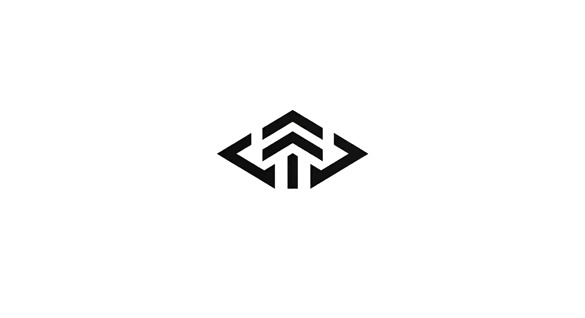
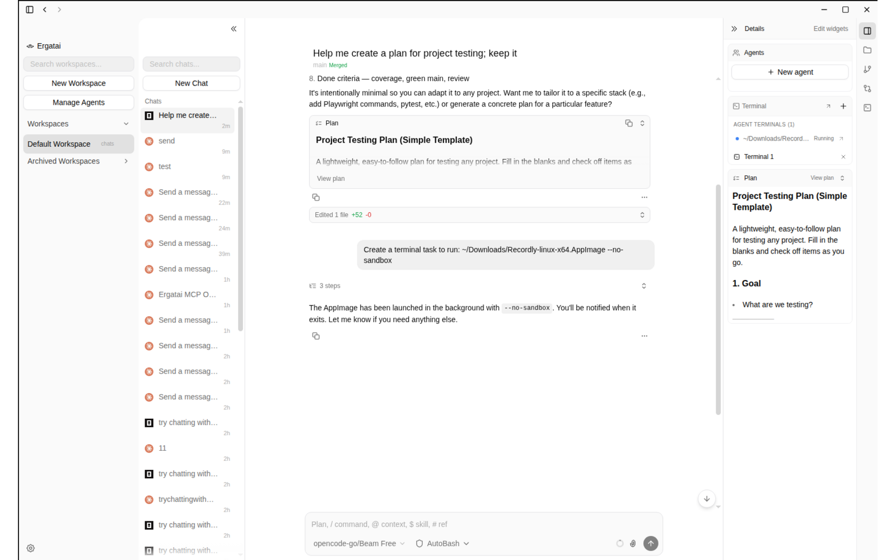
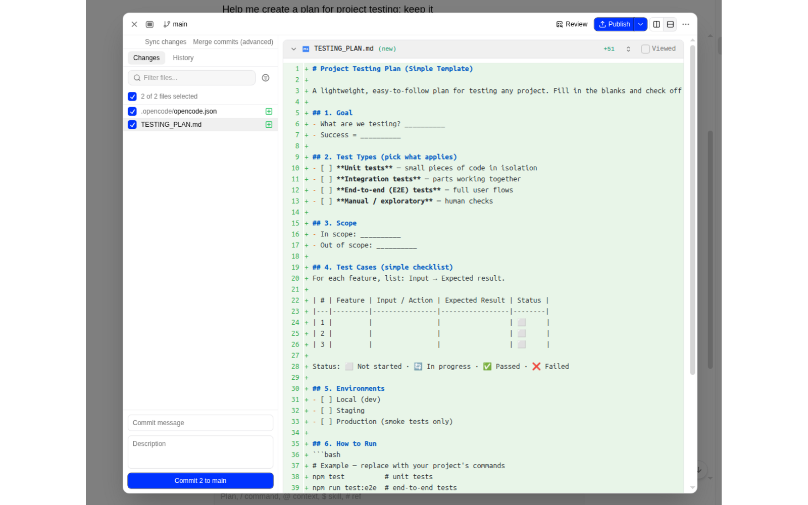
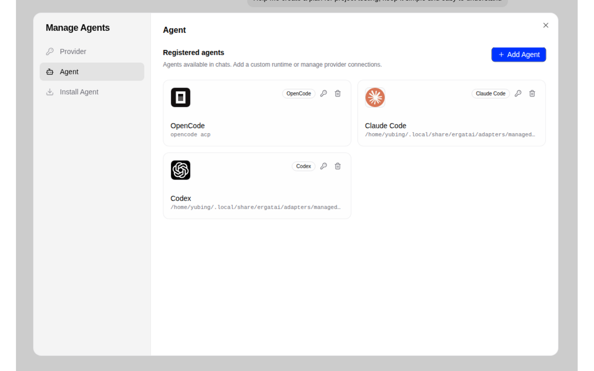
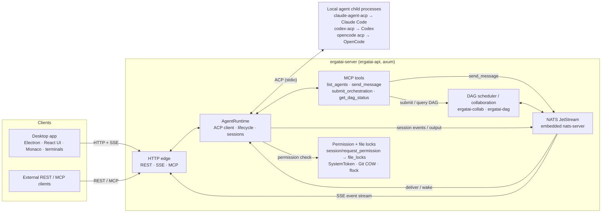

<div align="center">

# Ergatai

**Multi-agent collaboration workspace — Organize independent AI coding assistants into a collaborative team.**

[**ergatai**](https://github.com/windreach/ergatai) &nbsp;·&nbsp; [Docs](./docs) &nbsp;·&nbsp; [Issues](https://github.com/windreach/ergatai/issues)

[English](./README.md) | [简体中文](./README.zh-CN.md)

<sub>Ergatai is a project that connects multiple agents and helps them work together. It links independent AI
coding agents (Claude Code, Codex, OpenCode, Cursor, …) and assists them in collaborating through the
[Agent Client Protocol (ACP)](https://github.com/agentclientprotocol). Not affiliated with any of the upstream
agent vendors.</sub>


<br>



</div>

---

## Demo

<div align="center">

</div>

## Screenshots

<table>
<tr>
<td width="33%" valign="top">

### 🖥️ Desktop workspace

Main workspace with agent chats, file tree, and terminal panes.



</td>
<td width="33%" valign="top">

### 🔍 Diff review

Side-by-side diff review of agent edits before they land.



</td>
<td width="33%" valign="top">

### ⚙️ Manage agents & workspaces

Agent, workspace, and permission management panel.



</td>
</tr>
</table>

## Why

Today's agents are already quite capable at coding, but when you subscribe to multiple agent plans and point
them directly at a codebase, they often step on each other's changes. Ergatai exists to solve exactly this
problem.

- **Permission management.** Every agent modification must request permission; Ergatai attaches a permission
  lock at the request stage, so when multiple agents modify concurrently only the first lock holder
  succeeds — preventing agents from destroying each other's changes and wasting turns.
- **Local first.** Claude Code, Codex, OpenCode, etc. run through their native CLIs on your machine —
  reusing your existing logins and subscriptions, with no proxy in between.
- **Built-in git.** Every chat runs in its own isolated worktree; cross-chat modifications are protected
  after the fact.

## Features

- **ACP-native** — native support for ACP; extensible to more ACP-compatible agents in the future.
- **Zero-trust file access** — each agent's `SystemToken` plus `file_locks` records, Git copy-on-write snapshots, read locks tracked in SQLite WAL.
- **DAG orchestration** — agents submit YAML task graphs themselves; deadlines, node timeouts and stall watchdogs are enforced; mesh policies (Open / Adjacent / Star) govern inter-agent communication.
- **Reliable messaging** — NATS JetStream persistence, read receipts, request correlation + auto-timeout (`reqwatch`).
- **Agent supports** — opencode, claude, codex.

<sub>Extensible to ACP-compatible agents (not yet integrated or tested).</sub>

## How it works

Two tiers: clients and the local server. The desktop app connects to `ergatai-server` (`ergatai-api`, axum)
over HTTP + SSE. Every agent is a child process the server launches over ACP (stdio); `claude-agent-acp` and
`codex-acp` adapt those CLIs to ACP, while `opencode acp` speaks ACP natively, so logins and subscriptions stay
local. The server gives agents one MCP tool surface, uses an embedded NATS JetStream to persist and route
agent-to-agent messages, DAG events, and file events, and projects ACP session output into one event stream for
clients. File writes are gated at ACP permission time by `ergatai-lock` (`SystemToken` + `file_locks`, Git COW
snapshots, `flock`); the lock record itself is the permission proof.

MCP tools are declared per agent session, preferring HTTP `/mcp/{agent}`; agents without HTTP MCP use
MCP-over-ACP, then `mcp-stdio-adapter`.

Sequence-level flows for launch, prompting, messaging, permissions, and DAG execution are in
[`docs/architecture.md`](./docs/architecture.md).



| Layer | Where | What it does |
|---|---|---|
| Runtime | `crates/ergatai-runtime` | Agent lifecycle, ACP client/backends, sessions, profile registry |
| Collaboration | `crates/ergatai-collab` | DAG scheduler, task coordinator, collaboration sessions |
| DAG | `crates/ergatai-dag` | YAML parser, 9-rule validation, template engine |
| Lock | `crates/ergatai-lock` | File locks, Git COW snapshots, watchers |
| NATS | `crates/ergatai-nats` | Embedded nats-server + JetStream event bus |
| API | `crates/ergatai-api` | REST + MCP + SSE + metrics, permission broker |
| App | `frontend/` | Electron main (tRPC/IPC + HTTP/SSE) + React renderer |

## Download & build

Prebuilt portable bundles are published on the [GitHub Releases](https://github.com/windreach/ergatai/releases) page
(tagged `v*`); each release ships `ergatai-portable-*.zip` (Linux / macOS / Windows) plus `SHA256SUMS.txt`.

Build locally:

- Portable bundle: `./scripts/bundle.sh` → `frontend/release/ergatai-portable-*.zip`
- Packaged app: `./scripts/package.sh --platform linux|mac|win|all`
- Manual: `cargo build --workspace` + `cd frontend && bun install && bun run build`

<sub>Only Linux has been actually tested; Windows and macOS builds are produced by CI but have not been verified.</sub>

## Quick start

### Prerequisites

- Rust **1.88+** (`rust-version` in `Cargo.toml`)
- Node.js **20+** (for the desktop frontend)
- `cargo`, `bun` (npm is not supported — see `frontend/package.json` overrides)
- `nats-server` **2.10+** — the backend spawns it as a child process (it is not
  statically linked). Install it and make sure it is on `PATH`, or point
  `ERGATAI_NATS_BINARY` at the binary. On Debian/Ubuntu the package installs to
  `/usr/sbin/nats-server`, which is often not on a normal user's `PATH`:
  ```bash
  sudo apt-get install nats-server
  # if `nats-server` is not found afterwards:
  export ERGATAI_NATS_BINARY=/usr/sbin/nats-server
  ```

### Build & run

Development (starts backend + frontend together):

```bash
./scripts/dev.sh
```

Package for release:

```bash
./scripts/package.sh --platform linux   # mac | linux | win | all
```

<sub>Note: only Linux has been actually tested; Windows and macOS builds have not been verified. The packaging script bundles the current platform's `ergatai-server` (plus `nats-server` from PATH) into the Electron resources. The desktop app starts the backend on demand and reuses an already-running one. Use `--skip-backend` for a frontend-only artifact (required for cross-platform or `--platform all` builds).</sub>

Portable bundle:

```bash
./scripts/bundle.sh
```

Manual build (optional):

```bash
cargo build --workspace
cd frontend && bun install && bun run build
```

### Run the API server

```bash
cargo run -p ergatai-api -- --port 3000 --verbose

# With API token authentication
ERGATAI_API_TOKEN=secret cargo run -p ergatai-api -- --port 3000 --api-token secret

# With TLS
cargo run -p ergatai-api -- --tls-cert cert.pem --tls-key key.pem
```

## Interfaces

| Interface | Endpoint | Notes |
|---|---|---|
| REST API | `http://localhost:3000/api/v1/*` | Workspaces, agents, conversations, locks, activity |
| MCP | `POST /mcp/{agent}/*` | JSON-RPC 2025-06-18, one path per agent |
| SSE | `GET /api/v1/activity/stream` | Live activity events |
| Metrics | `GET /metrics` | Prometheus format |
| Desktop | Electron window | React + Monaco + terminal panes |

### MCP tools available to every agent

| Tool | Purpose |
|---|---|
| `list_agents` | Discover peers (with filters) |
| `send_message` | Rate-limited, conversation-guarded, mesh-policy-checked delivery |
| `submit_orchestration` | Submit a DAG workflow (YAML) |
| `validate_dag_yaml` | Dry-run DAG validation |
| `get_dag_status` | Inspect a running DAG + its collaboration session |

## Security & safety

- **Advisory file locks** — a `SystemToken` per session plus versioned `file_locks` records; Git COW snapshots prevent TOCTOU.
- **Per-agent rate limit** — sliding window, 60 msg/min (TOCTOU-safe).
- **NATS back-pressure** — 1000 pending messages → reject + 5s cache.
- **Mesh policy enforcement** — `send_message` is ACL-checked against every active `CollaborationSession`.
- **Defensive timeouts** — warn at 50%, escalate at 80%, fail at 100% of `node_timeout_secs`.
- **No secrets in source** — all auth via env vars (`ERGATAI_API_TOKEN`) or CLI flags.

See [`docs/architecture.md`](./docs/architecture.md) for the full data-flow diagrams, defensive controls, and
NATS subject naming.
## Testing

```bash
cargo test --workspace
cargo test -p ergatai-api
cargo test -p ergatai-runtime
cargo test -p ergatai-dag
cargo test -p ergatai-lock

cargo clippy --workspace -- -D warnings
cargo fmt --all
```

Frontend:

```bash
cd frontend && bun run check        # ts + api-boundaries + frontend-ids + feature-boundaries + file-size
cd frontend && bun run ts:check
```

## Configuration

| Env var | Default | Purpose |
|---|---|---|
| `ERGATAI_API_URL` | `http://localhost:3000` | Desktop client target |
| `ERGATAI_API_TOKEN` | — | API auth token |
| `ERGATAI_SSE_KEEP_ALIVE` | `15` | SSE keep-alive interval (seconds) |
| `ERGATAI_BACKPRESSURE_THRESHOLD` | `1000` | NATS pending-message ceiling |
| `ERGATAI_NATS_BINARY` | — | Override path to the `nats-server` binary (useful when it is installed in a directory not on `PATH`, e.g. `/usr/sbin/nats-server` on Debian/Ubuntu) |

Server flags (`ergatai-api`):

| Flag | Default | Purpose |
|---|---|---|
| `--port` | `3000` | Listen port |
| `--host` | `127.0.0.1` | Bind address |
| `--verbose` / `-v` | `false` | Debug logging |
| `--api-token` | — | Auth token (overrides env) |
| `--tls-cert` / `--tls-key` | — | PEM TLS certificate + key |
| `--sse-keep-alive` | `15` | SSE keep-alive interval |

## FAQ

<details>
<summary><b>Q1: Can Ergatai completely prevent agents from overwriting each other's concurrent edits?</b></summary>

Yes — as long as the permission mode is set to `ask` or `auto`, Ergatai has full control. The reason is that agents modifying files through their native edit tools (i.e., not via bash) go through the ACP permission gate, where Ergatai attaches a file lock at request time, so concurrent edits are serialized and only the first lock holder succeeds. Edits performed directly through bash bypass this gate and are therefore harder to defend against.

</details>

<details>
<summary><b>Q2: Does the project use git worktree isolation?</b></summary>

Yes. Different chats run on separate worktrees, but a single worktree typically hosts multiple agents. The project's permission model controls concurrent modifications within a worktree to prevent agents from overwriting each other.

</details>

<details>
<summary><b>Q3: Can I use this project for free?</b></summary>

Yes. The project is open source under the Apache License 2.0.

</details>

<details>
<summary><b>Q4: Is the project stable?</b></summary>

Not yet. The project still has many rough edges and known defects; use with caution.

</details>

<details>
<summary><b>Q5: Does the project collect telemetry?</b></summary>

No. The project is local-first and has zero telemetry.

</details>

## Contributing

Contributions welcome. Before opening a PR:

1. Run `cargo fmt --all` and `cargo clippy --workspace -- -D warnings`
2. Run `cd frontend && bun run check`
3. Add tests for any new behavior (target > 50% coverage for new modules)
4. Keep commits conventional (`feat:`, `fix:`, `refactor:`, …)
5. For runtime internals, see `CLAUDE.md` (agent-facing implementation notes) and [`docs/architecture.md`](./docs/architecture.md).

## License

[Apache License 2.0](LICENSE) © 2026 Ergatai Authors.

The desktop UI (`frontend/`) is derived from [1Code](https://1code.dev) by the
[21st.dev](https://21st.dev) team, licensed under the Apache License 2.0.
See `frontend/NOTICE` and `frontend/MODIFICATIONS.md` for attribution and modification details.

Ergatai is an independent project and is not affiliated with, endorsed by, or
associated with any of the upstream agent vendors.
