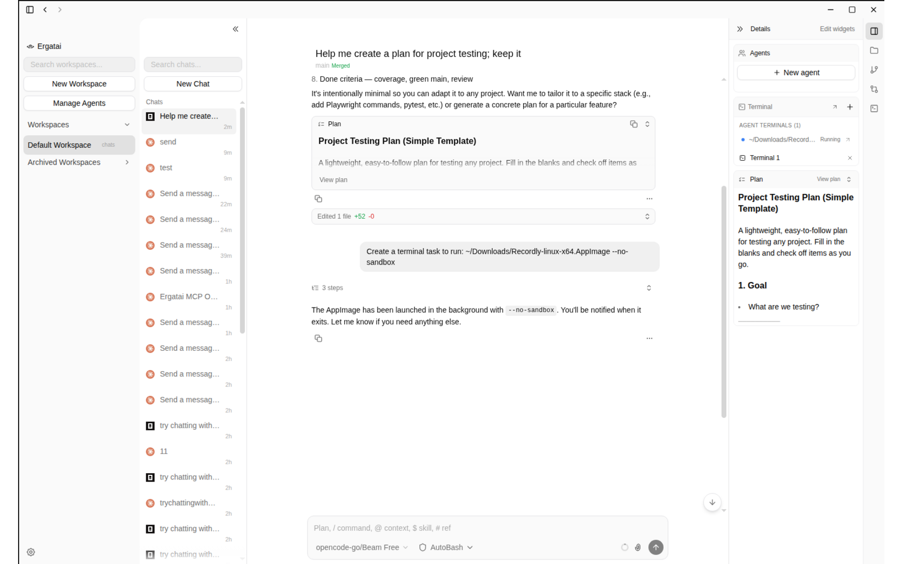
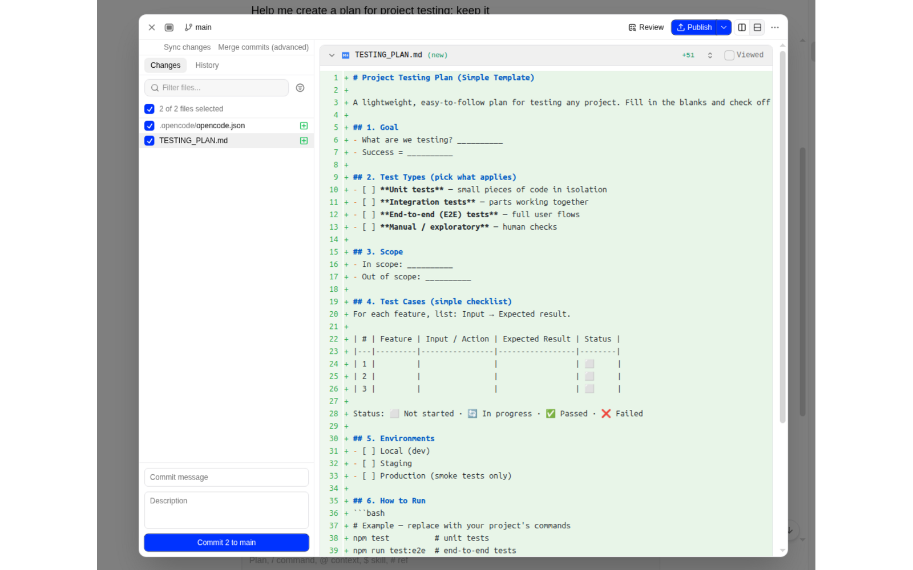
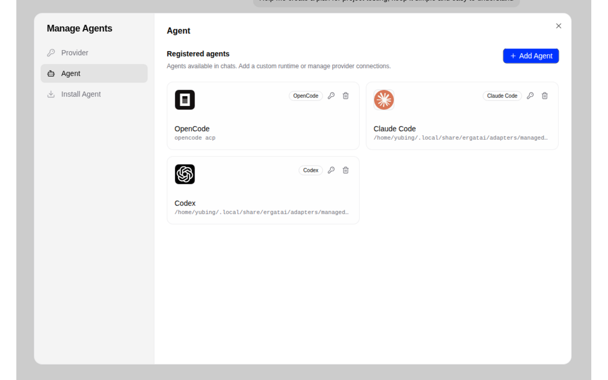
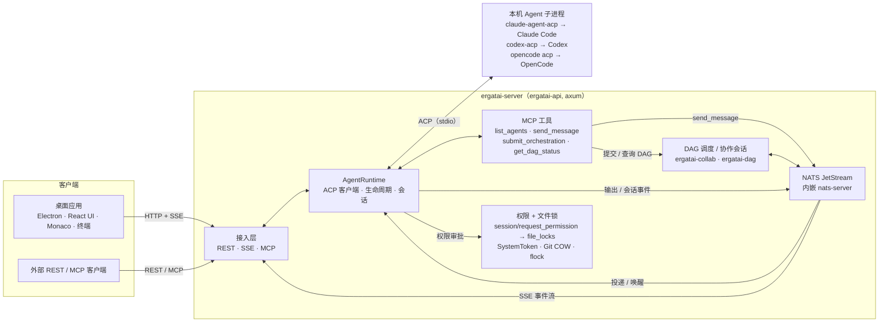

<div align="center">

# Ergatai

**多 Agent 协作工作台 — 把独立的 AI 编程助手组织成协作团队。**

[**ergatai**](https://github.com/windreach/ergatai) &nbsp;·&nbsp; [文档](./docs) &nbsp;·&nbsp; [Issues](https://github.com/windreach/ergatai/issues)

<sub>Ergatai 是一个连接多个 agent，并且协助 agent 们一起工作的项目。它把独立的 AI 编程助手
（Claude Code、Codex、OpenCode、Cursor 等）连接起来，通过
[Agent Client Protocol (ACP)](https://github.com/agentclientprotocol) 协助它们协同工作。
与任何上游 Agent 厂商无关联。</sub>


[](https://github.com/windreach/ergatai/stargazers)

<br>


</div>

---

[English](./README.md) | 简体中文

---

## 演示

<div align="center">

</div>

## 截图

<table>
<tr>
<td width="33%" valign="top">

### 🖥️ 桌面工作区

主工作区：agent 对话、文件树与终端面板。



</td>
<td width="33%" valign="top">

### 🔍 差异审阅

agent 修改落盘前的并排 diff 审阅。



</td>
<td width="33%" valign="top">

### ⚙️ 管理 agent 与工作区

agent、工作区与权限管理面板。



</td>
</tr>
</table>

---

## 为什么

当前 agent 的编码水平已经相当不错，但是当你订阅了多个 agent 套餐，拿来直接在代码库里往往容易出现互相踩脚变更，而 ergatai 正式为了解决这个问题。

- **权限管理**：agent 的每次修改都会强制要求发出权限申请，ergatai 的权限管理将会在申请阶段打上权限锁，让多个 agent 并发修改时只有第一个持有锁的 agent 将会成功，阻止 agent 互相破坏修改导致无意义的空转。
- **本地优先**：Claude Code、Codex、OpenCode 等通过原生 CLI 在本机运行 — 复用你现有的登录与订阅，中间没有代理。
- **内置 git**：每次 chat 都是在独立工作树上进行的，在跨 chat 中修改事件将会事后保护。

## 特性

- **Acp 原生** — 项目原生支持 ACP，未来可扩展接入更多支持 ACP 的 agent。
- **零信任文件访问** — 每个代理的 SystemToken 加上 file_locks 记录，Git 写时复制快照，读锁在 SQLite WAL 中跟踪。
- **DAG 编排** — Agent 自主提交 YAML 任务图；截止时间、节点超时与停滞看门狗均被强制执行；网格策略（Open / Adjacent / Star）控制 Agent 间通信。
- **可靠消息** — NATS JetStream 持久化、已读回执、请求关联 + 自动超时（`reqwatch`）。
- **Agent 支持** — opencode、claude、codex。

<sub>扩展性支持 ACP 适配 agent（暂未接入与测试）。</sub>

## 工作原理

两层：客户端与本地服务。桌面应用通过 HTTP + SSE 连接 `ergatai-server`（`ergatai-api`，axum）；每个
Agent 都是服务端通过 ACP（stdio）拉起的子进程，`claude-agent-acp` / `codex-acp` 把两家 CLI 适配为
ACP，`opencode acp` 则原生支持 ACP，登录与订阅仍在本机复用。服务端向 Agent 暴露统一的 MCP 工具面，用
内嵌 NATS JetStream 持久化并路由 Agent 间消息、DAG 事件与文件事件，再把 ACP 会话输出投影成统一事件流推给
客户端。文件写入在 ACP 权限审批阶段由 `ergatai-lock` 前置加锁（`SystemToken` + `file_locks`、Git COW
快照、`flock`），锁记录本身就是权限证明。

MCP 工具按 Agent 会话注入：优先使用 HTTP `/mcp/{agent}`；不支持 HTTP MCP 的 Agent 走 MCP-over-ACP，
再退回 `mcp-stdio-adapter`。

Agent 启动、Prompt/输出、消息、权限与 DAG 的时序数据流见 [`docs/architecture.zh-CN.md`](./docs/architecture.zh-CN.md)。



| 层 | 位置 | 职责 |
|---|---|---|
| 运行时 | `crates/ergatai-runtime` | Agent 生命周期、ACP 客户端/后端、会话、Profile 注册表 |
| 协作 | `crates/ergatai-collab` | DAG 调度器、任务协调器、协作会话 |
| DAG | `crates/ergatai-dag` | YAML 解析器、9 条规则校验、模板引擎 |
| 锁 | `crates/ergatai-lock` | 文件锁、Git COW 快照、文件监听 |
| NATS | `crates/ergatai-nats` | 内嵌 nats-server + JetStream 事件总线 |
| API | `crates/ergatai-api` | REST + MCP + SSE + 指标、权限代理 |
| 应用 | `frontend/` | Electron 主进程（tRPC/IPC + HTTP/SSE）+ React 渲染层 |

## 下载与构建

预编译的便携包发布在 [GitHub Releases](https://github.com/windreach/ergatai/releases) 页面（tag `v*`），
每个 release 包含 `ergatai-portable-*.zip` 和桌面安装包（Linux `.AppImage`/`.deb`，macOS `.dmg`；暂不支持 Windows）与 `SHA256SUMS.txt`。

本地构建：

- 便携包：`./scripts/bundle.sh` → `frontend/release/ergatai-portable-*.zip`
- 打包应用：`./scripts/package.sh --platform linux|mac|all`
- 手动：`cargo build --workspace` + `cd frontend && bun install && bun run build`

<sub>目前仅 Linux 经过完整实测；macOS 由 CI 构建但尚未验证；Windows 暂不支持，因为锁 IPC 与终端 PTY 当前依赖 Unix API。</sub>

## 快速开始

### 前置条件

- Rust **1.88+**（见 `Cargo.toml` 中的 `rust-version`）
- Node.js **20+**（桌面前端）
- `cargo`、`bun`（不支持 npm，详见 `frontend/package.json` 的 overrides）
- `nats-server` **2.10+** —— 后端会将其作为子进程拉起（并非静态链接）。请安装并确保在 `PATH` 上，或通过 `ERGATAI_NATS_BINARY` 指向二进制。Debian/Ubuntu 的包会安装到 `/usr/sbin/nats-server`，常不在普通用户的 `PATH` 上：
  ```bash
  sudo apt-get install nats-server
  # 若之后找不到 nats-server：
  export ERGATAI_NATS_BINARY=/usr/sbin/nats-server
  ```

### 构建与运行

开发（同时启动后端与前端）：

```bash
./scripts/dev.sh
```

打包发布：

```bash
./scripts/package.sh --platform linux   # mac | linux | all
```

<sub>注：仅 Linux 经过完整实测；macOS 构建尚未验证；Windows 暂不支持。打包脚本会把当前平台的 `ergatai-server`（以及 PATH 中的 `nats-server`）放进 Electron 资源目录，桌面应用启动时按需拉起后端；已有后端则直接复用。跨平台打包或 `--platform all` 请使用 `--skip-backend` 生成仅前端产物。</sub>

便携包：

```bash
./scripts/bundle.sh
```

手动构建（可选）：

```bash
cargo build --workspace
cd frontend && bun install && bun run build
```

### 运行 API 服务器

```bash
cargo run -p ergatai-api -- --port 3000 --verbose

# 启用 API Token 认证
ERGATAI_API_TOKEN=secret cargo run -p ergatai-api -- --port 3000 --api-token secret

# 启用 TLS
cargo run -p ergatai-api -- --tls-cert cert.pem --tls-key key.pem
```

## 接口

| 接口 | 端点 | 说明 |
|---|---|---|
| REST API | `http://localhost:3000/api/v1/*` | 工作区、Agent、对话、锁、活动 |
| MCP | `POST /mcp/{agent}/*` | JSON-RPC 2025-06-18，每 Agent 一路径 |
| SSE | `GET /api/v1/activity/stream` | 实时活动事件 |
| Metrics | `GET /metrics` | Prometheus 格式 |
| 桌面 | Electron 窗口 | React + Monaco + 终端面板 |

### 每个 Agent 可用的 MCP 工具

| 工具 | 用途 |
|---|---|
| `list_agents` | 发现对等 Agent（支持过滤） |
| `send_message` | 限流、对话守卫、网格策略检查后的投递 |
| `submit_orchestration` | 提交 DAG 工作流（YAML） |
| `validate_dag_yaml` | DAG 干跑校验 |
| `get_dag_status` | 查看运行中的 DAG 及其协作会话 |

## 安全与防护

- **咨询锁** — 每个会话一个 `SystemToken`，`file_locks` 记录带版本；Git COW 快照防止 TOCTOU。
- **每 Agent 限流** — 滑动窗口，60 条/分（防 TOCTOU）。
- **NATS 背压** — 1000 条待处理消息 → 拒绝 + 5 秒缓存。
- **网格策略强制** — `send_message` 对每个活跃 `CollaborationSession` 做 ACL 检查。
- **防御性超时** — 在 `node_timeout_secs` 的 50% 警告、80% 升级、100% 失败。
- **源码无密钥** — 认证全部通过环境变量（`ERGATAI_API_TOKEN`）或 CLI 标志。

完整数据流图、防御性控制与 NATS Subject 命名见 [`docs/architecture.zh-CN.md`](./docs/architecture.zh-CN.md)。
## 测试

```bash
cargo test --workspace
cargo test -p ergatai-api
cargo test -p ergatai-runtime
cargo test -p ergatai-dag
cargo test -p ergatai-lock

cargo clippy --workspace -- -D warnings
cargo fmt --all
```

前端：

```bash
cd frontend && bun run check        # ts + api-boundaries + frontend-ids + feature-boundaries + file-size
cd frontend && bun run ts:check
```

## 配置

| 环境变量 | 默认值 | 用途 |
|---|---|---|
| `ERGATAI_API_URL` | `http://localhost:3000` | 桌面客户端目标地址 |
| `ERGATAI_API_TOKEN` | — | API 认证令牌 |
| `ERGATAI_SSE_KEEP_ALIVE` | `15` | SSE 保活间隔（秒） |
| `ERGATAI_BACKPRESSURE_THRESHOLD` | `1000` | NATS 待处理消息上限 |

`ergatai-api` 服务器标志：

| 标志 | 默认值 | 用途 |
|---|---|---|
| `--port` | `3000` | 监听端口 |
| `--host` | `127.0.0.1` | 绑定地址 |
| `--verbose` / `-v` | `false` | 调试日志 |
| `--api-token` | — | 认证令牌（覆盖环境变量） |
| `--tls-cert` / `--tls-key` | — | PEM TLS 证书 + 密钥 |
| `--sse-keep-alive` | `15` | SSE 保活间隔 |

## 常见问题

<details>
<summary><b>Q1：Ergatai 能否完全阻止 agent 并发修改覆盖？</b></summary>

能 —— 只要权限模式设置为 `ask` 或 `auto`，项目就能完全控制。原因是 agent 通过原生编辑工具（即非 bash）修改文件时，会经过 ACP 权限闸门，Ergatai 会在申请阶段打上文件锁，从而使并发修改串行化，只有第一个持有锁的 agent 能成功。直接通过 bash 进行的修改会绕过该闸门，因此更难防御。

</details>

<details>
<summary><b>Q2：项目是否会采用 git worktree 隔离？</b></summary>

会。不同 chat 运行在不同的 worktree 上，但一个 worktree 通常会运行多个 agent。项目的权限模型会控制 worktree 内的并发修改，防止 agent 互相覆盖。

</details>

<details>
<summary><b>Q3：我可以免费使用这个项目吗？</b></summary>

可以。项目当前采用 Apache 2.0 开源协议。

</details>

<details>
<summary><b>Q4：当前项目稳定吗？</b></summary>

并不稳定，项目还存在许多缺陷。

</details>

<details>
<summary><b>Q5：项目会收集遥测数据吗？</b></summary>

不会。项目本地优先，零遥测。

</details>

## 支持 Ergatai

如果 Ergatai 节约了你的时间，让 agent 可以更好的协作，欢迎点个 Star ⭐ —— 这能让更多开发者发现这个项目，也是我们持续维护的动力。

[](https://github.com/windreach/ergatai/stargazers)

## 贡献

欢迎贡献。提交 PR 前：

1. 运行 `cargo fmt --all` 与 `cargo clippy --workspace -- -D warnings`
2. 运行 `cd frontend && bun run check`
3. 为新行为添加测试（新模块目标覆盖率 > 50%）
4. 提交信息遵循约定式提交（`feat:`、`fix:`、`refactor:` …）
5. 底层实现与不变量见 `CLAUDE.md`（面向编码 Agent 的仓库说明）及 [`docs/architecture.zh-CN.md`](./docs/architecture.zh-CN.md)。

## 许可证

[Apache License 2.0](LICENSE) © 2026 Ergatai Authors。

桌面 UI（`frontend/`）衍生自 [1Code](https://1code.dev)（[21st.dev](https://21st.dev) 团队），采用 Apache License 2.0。
归属与修改详情见 `frontend/NOTICE` 与 `frontend/MODIFICATIONS.md`。

Ergatai 是独立项目，与任何上游 Agent 厂商无关联、未获其背书。
