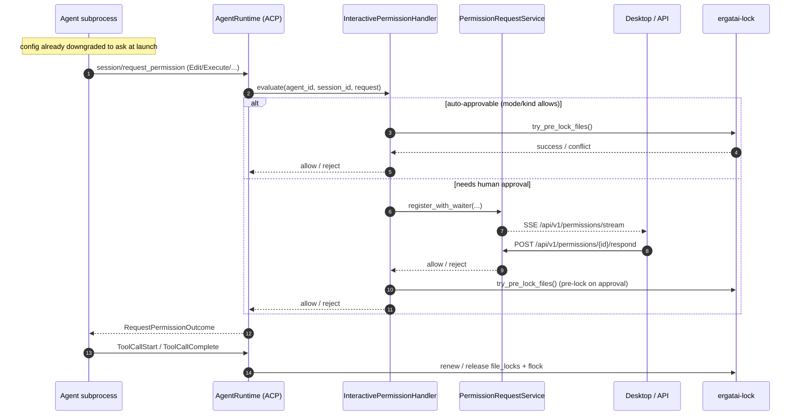

# Why Ergatai Can "Lock" an Agent: How It Works

> This document explains how Ergatai turns an AI coding agent that is normally
> allowed to approve its own actions into a managed agent that must ask Ergatai
> first — and how Ergatai attaches file locks at that moment.

## 1. Background: the problem is not "agents can't code", it's "agents race to write"

Ergatai puts multiple independent AI coding agents (Claude Code, Codex, OpenCode, …)
into one workspace to collaborate. Each agent ships its own permission/approval
mechanism: by default it auto-approves its own file edits, command execution, etc.,
or only asks the user in a few cases.

If agents are left to approve themselves, Ergatai **never sees** those operations
happen, so it cannot:

- acquire a write lock before the operation;
- serialize two agents editing the same file;
- put the allow/deny decision in the hands of the user or Ergatai's approver.

So Ergatai's first move is to **disable the agent's self-approval capability** and
force every privileged operation through the ACP `session/request_permission`
round-trip, where Ergatai's built-in approver decides whether to allow it — and
attaches a file lock when it does.

That is the whole principle of "locking an agent": **not killing or pausing the
agent process, but downgrading the agent's permission mode to `ask` and letting
Ergatai's approver be the sole gatekeeper.**

## 2. Core flow



## 3. Step 1: rewrite the agent's project config at launch to downgrade permissions to `ask`

In the agent launch flow in `crates/ergatai-runtime/src/backends/acp.rs`, Ergatai
detects the agent type from the command and writes/overwrites a project-level config
under the work directory, setting every tool's permission to "ask". Key code comment:

> Claude Code permission injection: ensure project-level settings ask for all tools.

### 3.1 Claude Code — `.claude/settings.json`

```json
{
  "ergatai_managed": true,
  "permissions": {
    "defaultMode": "manual",
    "ask": ["*", "Bash", "Read", "Edit", "Write", "Glob", "Grep",
            "WebFetch", "WebSearch", "Task", "NotebookEdit"]
  }
}
```

- `defaultMode = "manual"`: enter manual approval mode by default;
- `ask = ["*", ...]`: every tool (including the wildcard) must ask.

### 3.2 OpenCode — `.opencode/opencode.json`

```json
{
  "$schema": "https://opencode.ai/config.json",
  "ergatai_managed": true,
  "permission": {
    "*": "ask",
    "read": "ask",
    "edit": "ask",
    "bash": "ask",
    "glob": "ask",
    "grep": "ask",
    "webfetch": "ask",
    "websearch": "ask",
    "doom_loop": "ask",
    "external_directory": "ask"
  }
}
```

OpenCode's built-in defaults are `allow` for most tools, so relying on `"*": "ask"`
alone is not enough; Ergatai explicitly sets every core tool to `ask`.

### 3.3 Codex — `.codex/config.toml`

```toml
ergatai_managed = true
approval_policy = "on-request"
sandbox_mode = "read-only"
```

Plus an injected environment variable:

```text
INITIAL_AGENT_MODE=read-only
```

- `approval_policy = "on-request"`: approve only on request;
- `sandbox_mode = "read-only"`: force read-only startup so every file edit/command
  goes through an ACP `session/request_permission` round-trip instead of being
  auto-approved by Codex's "agent (auto-review)" preset.

### 3.4 Why it must be written before launch

These configs are read by the agent process **at startup**. If the agent already
runs in auto-approve mode, changing config later is too late — the operation has
already happened. Ergatai therefore writes them in `AgentLauncher.launch()`
**before** spawning the process, so from the very first turn every privileged
operation must ask Ergatai.

Configs are marked `ergatai_managed = true` to distinguish Ergatai-managed
settings from user-authored ones (Codex overwrites to avoid stale invalid
`[permissions]` sections).

## 4. Step 2: ACP permission requests enter Ergatai's built-in approver

Once downgraded to `ask`, every Edit/Delete/Move/Execute/... triggers a
`session/request_permission` to the ACP host. Ergatai registers
`InteractivePermissionHandler` as the ACP backend's permission handler at startup
(set `ERGATAI_PERMISSION_MODE=yolo` to revert to the legacy
`YoloPermissionHandler` auto-approve mode).

### 4.1 The built-in approver: `InteractivePermissionHandler`

Located in `crates/ergatai-runtime/src/permission.rs`. It splits "whether to ask
the user" from "whether to lock" into two layers:

1. **Policy layer**: decide `force_ask` from permission mode, whether the agent is
   autonomous (DAG worker), whether the operation escapes the workspace, and tool
   kind.
2. **Lock layer**: for write operations, call `try_pre_lock_files()` on every path
   — auto or manual — and reject on conflict.

### 4.2 Permission modes

| Mode | Behavior |
|---|---|
| `Ask` | Ask for everything except Read/Think/SwitchMode/Other |
| `Auto` (default) | Auto-approve in-workspace writes; ask for Bash/Execute/Fetch and out-of-workspace paths |
| `AutoBash` | Bash/Execute unconditionally auto-approved (incl. out-of-workspace); other policy unchanged |
| `FullAccess` | Auto-approve everything and **skip file-lock checks** |

Mode is stored in a global atomic in `permission_service.rs`; the frontend can switch it.

### 4.3 Auto-approve path

```text
if !force_ask:
    if FullAccess / AutoBash+Bash:
        best-effort pre-lock (in-workspace only; failure not blocking)
        return allow
    if Edit/Delete/Move/Execute:
        try_pre_lock_files()   // failure → reject
        return allow
    return allow
```

### 4.4 Human-approval path

1. Build a `PendingPermissionRequest`, register it via
   `PermissionRequestService::register_with_waiter` with a oneshot waiter;
2. Push to the Desktop over SSE `/api/v1/permissions/stream`;
3. Desktop calls `POST /api/v1/permissions/{id}/respond`;
4. Approver waits up to **5 minutes**; timeout is treated as rejection;
5. On allow:
   - out-of-workspace paths: allow directly (lock manager does not govern them);
   - in-workspace: call `try_pre_lock_files()`; **lock conflict still rejects**
     (the user's "allow" is permission-to-try, not permission-to-stomp).

### 4.5 File-lock pre-claim: `try_pre_lock_files()`

Located in `permission.rs`. It acquires write locks **before** the tool runs:

| ToolKind | Action |
|---|---|
| Edit / Delete / Move | Pre-claim a write lock per location; conflict → `Err` |
| Execute (Bash) | Statically analyze the command to extract write targets, then pre-claim; extraction failure → proceed (watcher fallback) |
| Others | No-op |

On failure, already-acquired locks are rolled back and `LockConflict` is returned,
which the approver turns into a rejection.

### 4.6 Autonomous agents (DAG workers)

DAG workers marked via `mark_agent_autonomous()` have no interactive user.
In-workspace operations are auto-approved, but **file-lock checks still apply**;
out-of-workspace paths still ask (and ultimately time out to rejection).

## 5. Why this "locks" the agent

Putting the two steps together:

1. **The agent can no longer approve itself**: config downgraded to `ask`, so every
   privileged operation must round-trip through `request_permission`, and the host
   is Ergatai.
2. **Ergatai is the sole gatekeeper**: `InteractivePermissionHandler` is the only
   permission handler registered on the ACP backend. The agent cannot bypass it
   for structured tool calls (Bash is the exception, see below).
3. **Allow implies lock**: the approver calls `try_pre_lock_files()` before
   allowing, writing a `file_locks` record and `flock(LOCK_EX)`. When a second
   agent requests the same file, pre-claim fails and the tool call is rejected —
   mutual exclusion achieved.
4. **The lock record is the proof**: `file_locks` is the permission proof; no
   separate token is needed.

In short, Ergatai does not kill or pause the agent process. It **takes away the
agent's ability to approve its own operations**, turning every operation into
"must ask Ergatai first", and locks the file at the moment of approval. The agent
keeps running and thinking, but its write scope is jointly constrained by the
approver and the locks.

## 6. Boundaries and exceptions

- **Bash writes bypass the gate**: edits via native tools (not bash) go through
  the ACP permission gate where Ergatai attaches locks; edits performed directly
  through bash bypass it and are harder to defend. Ergatai statically extracts
  paths from bash commands and pre-claims locks, falling back to post-hoc file
  watching when extraction fails.
- **`flock` is advisory**: `flock(LOCK_EX)` only constrains cooperating processes
  that also call `flock`; raw bash is not blocked by it and is covered by
  snapshots + watcher.
- **`FullAccess` gives up control**: in that mode everything is auto-approved and
  lock checks are skipped.
- **`AutoBash` mode**: Bash/Execute unconditionally approved, but other writes
  are still locked.
- **Out-of-workspace paths**: the lock manager only governs paths under registered
  project roots; explicitly approved out-of-workspace requests are not locked.
- **Infrastructure degradation**: when `workspace_id` cannot be derived or the
  lock manager is uninitialized, `try_pre_lock_files()` degrades to a no-op and
  the tool still runs (watcher fallback). This keeps the system usable but means
  locks may be ineffective in extreme cases.

## 7. Typical concurrent scenario

```text
Agent A and Agent B both try to edit src/main.rs
  A: request_permission(Edit, src/main.rs)
     → InteractivePermissionHandler: force_ask? (Auto, in-workspace → false)
     → try_pre_lock_files: try_acquire_write_lock_preemptive → success
     → allow
  B: request_permission(Edit, src/main.rs)
     → try_pre_lock_files: try_acquire_write_lock_preemptive → LockConflict
     → reject
  Result: only A modifies the file; B is rejected and must re-read A's result
```

## 8. Code index

| Topic | Location |
|---|---|
| Permission-config injection at launch | `crates/ergatai-runtime/src/backends/acp.rs` (Claude/OpenCode/Codex sections) |
| ACP permission handler trait + InteractivePermissionHandler | `crates/ergatai-runtime/src/permission.rs` |
| Permission modes / autonomous agents / service | `crates/ergatai-runtime/src/permission_service.rs` |
| Approver registration | `crates/ergatai-api/src/main.rs` (`InteractivePermissionHandler` / `YoloPermissionHandler`) |
| Lock-aware handler (legacy path) | `crates/ergatai-api/src/lock_permission.rs` |
| File lock manager | `crates/ergatai-lock/src/lock_manager.rs`, `manager.rs` |
| Architecture (permissions & file locks) | `docs/architecture.md` §7 |

## 9. FAQ

**Q: Why not just kill or pause the agent?**
A: Ergatai is local-first and reuses native CLIs. Killing a process would destroy
agent context and session recovery. Downgrading permissions + approver lets the
agent keep thinking and reading; only writes must be requested first.

**Q: Can the agent revert its own config?**
A: The agent runs in the work directory and could edit `.claude/settings.json`
etc., but Ergatai rewrites these configs on every launch, and `ergatai_managed = true`
marks them. More fundamentally, Ergatai only locks operations that pass the ACP
gate, so use `Ask`/`Auto` mode and avoid over-broad Bash permissions.

**Q: Why can Bash still bypass?**
A: Bash is process-level execution and does not go through the structured ACP
permission gate. Ergatai statically extracts paths and pre-claims locks, with file
watching as fallback, but cannot guarantee 100% defense. This is a known boundary.

**Q: Can you still "lock" in `FullAccess` mode?**
A: No. In that mode the approver skips all prompts and lock checks, so Ergatai
loses control over the agent.

---

*See also: [Architecture and Data Flow](./architecture.md) §7 Permission Approval and File Locks.*
