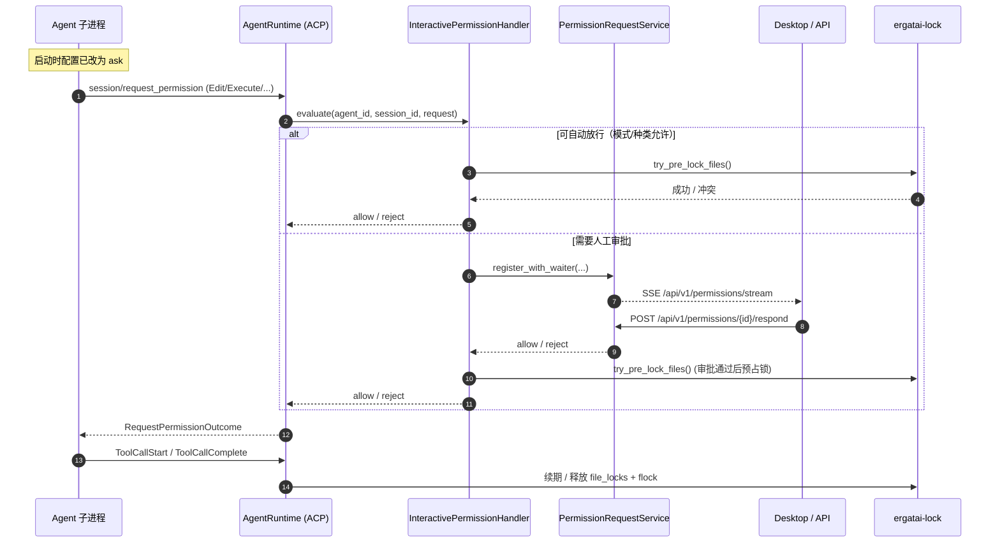

# 为什么可以"锁住" Agent：工作原理

> 本文解释 Ergatai 如何把一个原本"自己就能批准自己操作"的 AI 编码 Agent，
> 变成必须先向 Ergatai 申请、并允许 Ergatai 附加上文件锁的"被管控 Agent"。

## 1. 背景：问题不是"Agent 不会写代码"，而是"Agent 会抢着写"

Ergatai 把多个独立的 AI 编码 Agent（Claude Code、Codex、OpenCode 等）放进同一个
工作区协作。每个 Agent 本身都有一套**内置的权限/审批机制**：在默认配置下，
它们会自动批准自己的文件编辑、命令执行等操作，或者只在极少数情况下才询问用户。

如果任由 Agent 自行批准，Ergatai 就**永远看不到**这些操作的发生，因此也：

- 无法在操作前给文件加上写锁；
- 无法在两个 Agent 同时修改同一文件时进行互斥；
- 无法把"允许/拒绝"的决定权交给用户或 Ergatai 的审批器。

所以 Ergatai 要做的第一件事，就是**把 Agent 的"自治审批能力"关掉**，让所有特权操作
都必须走 ACP 的 `session/request_permission` 往返，再由 Ergatai 的内置审批器决定
是否放行——放行的同时附加上文件锁。

这就是"锁住 Agent"的全部原理：**不是去拦截 Agent 的进程，而是把 Agent 的权限模式
降级为 `ask`，再由 Ergatai 的审批器统一放行。**

## 2. 核心链路



## 3. 第一步：启动时改写 Agent 项目配置，把权限降级为 `ask`

在 `crates/ergatai-runtime/src/backends/acp.rs` 的 Agent 启动流程中，Ergatai 会根据
命令行识别 Agent 类型，并在**工作目录**下写入/覆盖项目级配置，把所有工具的权限
都改成"询问"。关键代码段：

> Claude Code 权限注入：确保项目级 settings 要求所有工具都询问。

### 3.1 Claude Code — `.claude/settings.json`

```json
{
  "ergatai_managed": true,
  "permissions": {
    "defaultMode": "manual",
    "ask": ["*", "Bash", "Read", "Edit", "Write", "Glob", "Grep",
            "WebFetch", "WebSearch", "Task", "NotebookEdit"]
  }
}
```

- `defaultMode = "manual"`：默认进入手动审批模式；
- `ask = ["*", ...]`：所有工具（含通配）都必须询问。

### 3.2 OpenCode — `.opencode/opencode.json`

```json
{
  "$schema": "https://opencode.ai/config.json",
  "ergatai_managed": true,
  "permission": {
    "*": "ask",
    "read": "ask",
    "edit": "ask",
    "bash": "ask",
    "glob": "ask",
    "grep": "ask",
    "webfetch": "ask",
    "websearch": "ask",
    "doom_loop": "ask",
    "external_directory": "ask"
  }
}
```

OpenCode 的内置默认对大多数工具是 `allow`，仅靠 `"*": "ask"` 不够，因此 Ergatai
**显式**把每个核心工具都设为 `ask`。

### 3.3 Codex — `.codex/config.toml`

```toml
ergatai_managed = true
approval_policy = "on-request"
sandbox_mode = "read-only"
```

并额外注入环境变量：

```text
INITIAL_AGENT_MODE=read-only
```

- `approval_policy = "on-request"`：仅在请求时审批；
- `sandbox_mode = "read-only"`：强制以只读模式启动，使每次文件编辑/命令都必须
  走 ACP `session/request_permission` 往返，而不是被 Codex 的"agent（自动审查）"
  预设自动批准。

### 3.4 为什么必须在启动前写入

这些配置是 Agent 进程**启动时读取**的。如果 Agent 已经以"自动批准"模式运行，
Ergatai 再去改配置也来不及——操作已经发生。因此 Ergatai 选择在
`AgentLauncher.launch()` 生成进程**之前**写入配置，保证从第一轮对话开始，
Agent 的每次特权操作都必须向 Ergatai 申请。

配置文件上会标记 `ergatai_managed = true`，表明这是 Ergatai 管理的配置，
避免与用户手写配置混淆（Codex 为避免残留非法 `[permissions]` 段，采用覆盖写入）。

## 4. 第二步：ACP 权限请求进入 Ergatai 内置审批器

Agent 一旦被降级为 `ask`，每次 Edit/Delete/Move/Execute/... 都会向 ACP 主机发送
`session/request_permission`。Ergatai 在启动时把 `InteractivePermissionHandler`
注册为 ACP 后端的权限处理器（`ERGATAI_PERMISSION_MODE=yolo` 可切回旧的
`YoloPermissionHandler` 自动批准模式）。

### 4.1 内置审批器：`InteractivePermissionHandler`

位于 `crates/ergatai-runtime/src/permission.rs`。它把"是否询问用户"和"是否加锁"
分成两层：

1. **策略层**：根据权限模式、Agent 是否自主（DAG 工作节点）、操作是否越出工作区、
   工具种类，决定是否 `force_ask`。
2. **锁层**：无论自动放行还是人工批准，写操作都要调用 `try_pre_lock_files()`
   预占写锁；锁冲突直接拒绝。

### 4.2 权限模式

| 模式 | 行为 |
|---|---|
| `Ask` | 除读/思考/切换模式/其他外，所有操作都询问用户 |
| `Auto`（默认） | 工作区内写操作自动放行；Bash/Execute/Fetch 与越界路径询问 |
| `AutoBash` | Bash/Execute 无条件自动放行（含越界）；其他策略不变 |
| `FullAccess` | 全部自动放行，**跳过文件锁检查** |

模式存储在 `permission_service.rs` 的全局原子变量中，前端可切换。

### 4.3 自动放行路径

```text
if !force_ask:
    if FullAccess / AutoBash+Bash:
        best-effort pre-lock（仅工作区内，失败不阻断）
        return allow
    if Edit/Delete/Move/Execute:
        try_pre_lock_files()   // 失败 → reject
        return allow
    return allow
```

### 4.4 人工审批路径

1. 构造 `PendingPermissionRequest`，通过 `PermissionRequestService::register_with_waiter`
   注册，并把 oneshot waiter 交给审批器；
2. 通过 SSE `/api/v1/permissions/stream` 推送给 Desktop；
3. Desktop 调用 `POST /api/v1/permissions/{id}/respond` 提交决定；
4. 审批器等待最多 **5 分钟**，超时视为拒绝；
5. 用户允许后：
   - 越界路径：直接 allow（锁管理器不管辖工作区外路径）；
   - 工作区内：调用 `try_pre_lock_files()`，**锁冲突仍然拒绝**（用户的"允许"
     只是"允许尝试"，不是"允许踩踏"）。

### 4.5 文件锁预占：`try_pre_lock_files()`

位于 `permission.rs`。它在工具**执行前**就获取写锁：

| ToolKind | 动作 |
|---|---|
| Edit / Delete / Move | 对每个 location 尝试预占写锁；冲突 → `Err` |
| Execute (Bash) | 静态分析命令，提取写目标路径，再预占；提取失败 → 放行（由 watcher 兜底） |
| 其他 | 空操作 |

锁获取失败时会回滚已获取的锁，返回 `LockConflict`，审批器据此拒绝工具调用。

### 4.6 自主 Agent（DAG 工作节点）

通过 `mark_agent_autonomous()` 标记的 DAG 工作节点没有交互用户。它们在工作区内
自动放行，但**仍要过文件锁检查**；越界路径仍会询问（最终超时拒绝）。

## 5. 为什么这样就能"锁住" Agent

把上面两步连起来看：

1. **Agent 不能自己批准了**：配置被降级为 `ask`，它的每次特权操作都必须向主机
   发起 `request_permission` 往返，而主机就是 Ergatai。
2. **Ergatai 是唯一放行者**：`InteractivePermissionHandler` 是 ACP 后端注册的
   唯一权限处理器。Agent 无法绕过它去执行写操作（除非走 Bash 直接写文件，
   见下节）。
3. **放行即加锁**：审批器在 allow 之前调用 `try_pre_lock_files()`，把写锁记录写入
   `file_locks` 并 `flock(LOCK_EX)`。第二个 Agent 再请求同一文件时，预占锁失败，
   工具调用被拒绝，从而实现互斥。
4. **锁记录即证明**：`file_locks` 记录本身就是权限证明，无需额外 token。

换句话说，Ergatai 并不是"杀死或暂停"Agent 进程，而是**拿走了 Agent 自己批准
操作的能力**，把所有操作都变成"必须向 Ergatai 申请"，再在申请通过的瞬间把文件
锁上。Agent 仍然在运行，但它能动的范围被 Ergatai 的审批器和锁共同约束。

## 6. 边界与例外

- **Bash 直接写文件绕过门禁**：Agent 通过原生编辑工具（非 bash）修改文件时，
  会走 ACP 权限门禁，Ergatai 可以加锁；但通过 Bash 直接写文件会绕过该门禁，
  因此更难防御。Ergatai 对 Bash 会做静态路径提取并预占锁，提取失败时退化为
  事后文件监听（watcher）兜底。
- **`flock` 是建议锁**：`flock(LOCK_EX)` 只约束同样调用 `flock` 的协作进程；
  原始 Bash 不受它约束，只能靠快照 + 监听。
- **`FullAccess` 模式放弃锁定**：选择该模式时，所有操作自动放行且跳过锁检查，
  Ergatai 失去控制能力。
- **`AutoBash` 模式**：Bash/Execute 无条件放行，但仍对其他写操作加锁。
- **越界路径**：锁管理器只管辖注册项目根目录内的路径；用户显式批准越界请求时
  不尝试加锁。
- **基础设施降级**：当 `workspace_id` 无法推导或锁管理器未初始化时，预占锁函数
  会退化为 no-op，工具仍然执行，由 watcher 兜底。这是为了保证系统可用性，但
  意味着极端情况下锁可能失效。

## 7. 典型并发场景

```text
Agent A 和 Agent B 同时尝试编辑 src/main.rs
  A: request_permission(Edit, src/main.rs)
     → InteractivePermissionHandler: force_ask? (Auto 模式、工作区内 → false)
     → try_pre_lock_files: try_acquire_write_lock_preemptive → 成功
     → allow
  B: request_permission(Edit, src/main.rs)
     → try_pre_lock_files: try_acquire_write_lock_preemptive → LockConflict
     → reject
  结果：只有 A 能修改；B 收到拒绝，需要重新读取 A 的结果后再尝试
```

## 8. 相关代码索引

| 主题 | 位置 |
|---|---|
| Agent 启动时的权限配置注入 | `crates/ergatai-runtime/src/backends/acp.rs`（Claude/OpenCode/Codex 三段） |
| ACP 权限处理器 trait 与 InteractivePermissionHandler | `crates/ergatai-runtime/src/permission.rs` |
| 权限模式 / 自主 Agent / 服务 | `crates/ergatai-runtime/src/permission_service.rs` |
| 内置审批器注册 | `crates/ergatai-api/src/main.rs`（`InteractivePermissionHandler` / `YoloPermissionHandler`） |
| 锁感知处理器（旧路径） | `crates/ergatai-api/src/lock_permission.rs` |
| 文件锁管理器 | `crates/ergatai-lock/src/lock_manager.rs`、`manager.rs` |
| 架构说明（权限与文件锁） | `docs/architecture.md` §7 |

## 9. FAQ

**Q: 为什么不直接杀掉或暂停 Agent？**
A: Ergatai 的设计是"本地优先、复用原生 CLI"。暂停进程会破坏 Agent 的上下文与
会话恢复。通过权限降级 + 审批器，Agent 仍可正常思考与读取，只是写操作必须
先申请。

**Q: Agent 能不能自己把配置改回去？**
A: Agent 运行在工作目录下，理论上可以编辑 `.claude/settings.json` 等文件；但 Ergatai
在每次启动时会**重新写入**这些配置，且 `ergatai_managed = true` 标记便于识别。
更根本的保障是：即使 Agent 改回自动批准，Ergatai 也只对"走 ACP 门禁的操作"加锁；
因此仍建议在 `Ask`/`Auto` 模式下使用，并避免给 Agent 过宽的 Bash 权限。

**Q: 为什么 Bash 还能绕过？**
A: Bash 是进程级执行，不经过 ACP 的结构化权限门禁。Ergatai 对 Bash 做静态路径
提取 + 预占锁，并用文件监听兜底，但无法做到 100% 防御。这是当前架构的已知边界。

**Q: `FullAccess` 模式下还能"锁住"吗？**
A: 不能。该模式下审批器跳过所有询问与锁检查，Ergatai 失去对 Agent 的控制。

---

*相关：[架构与数据流](./architecture.zh-CN.md) §7 权限审批与文件锁。*
