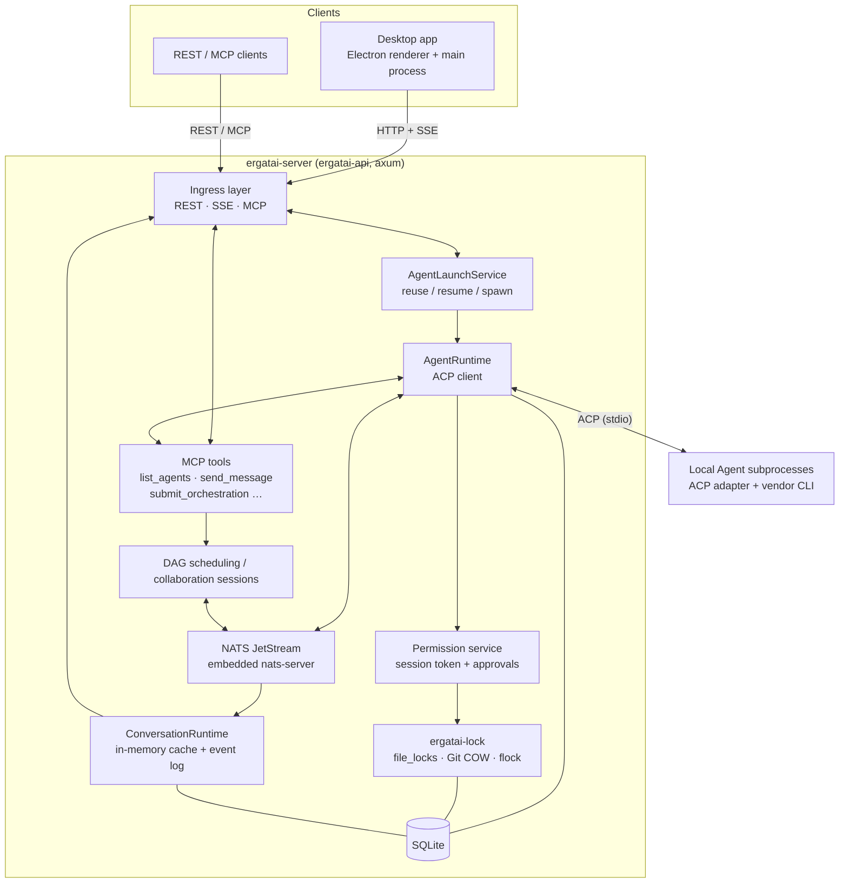
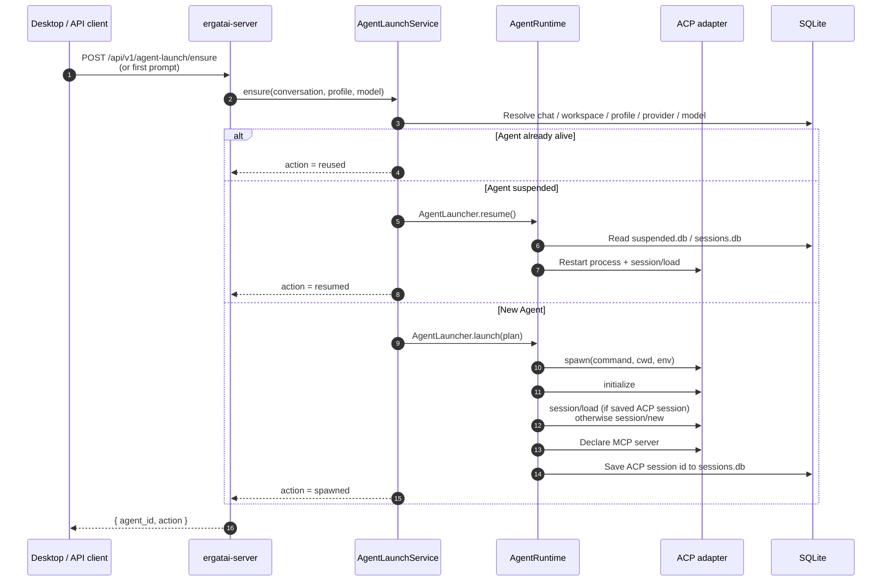
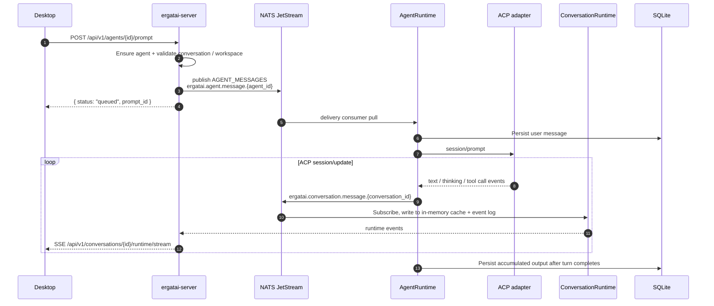
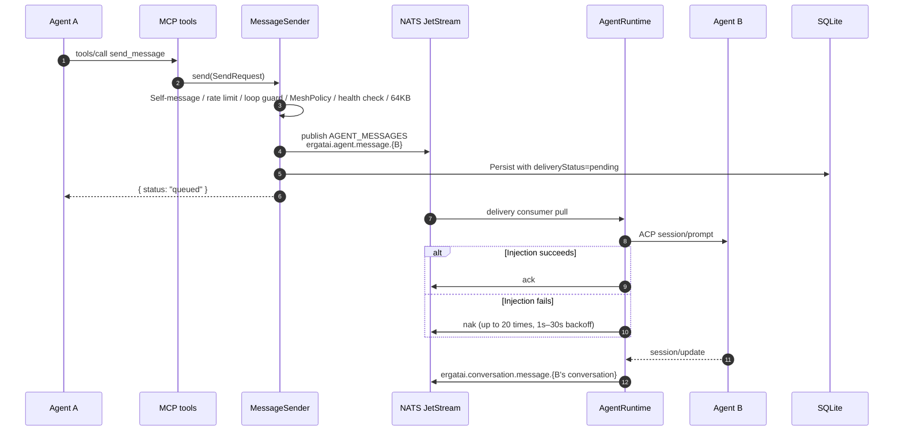
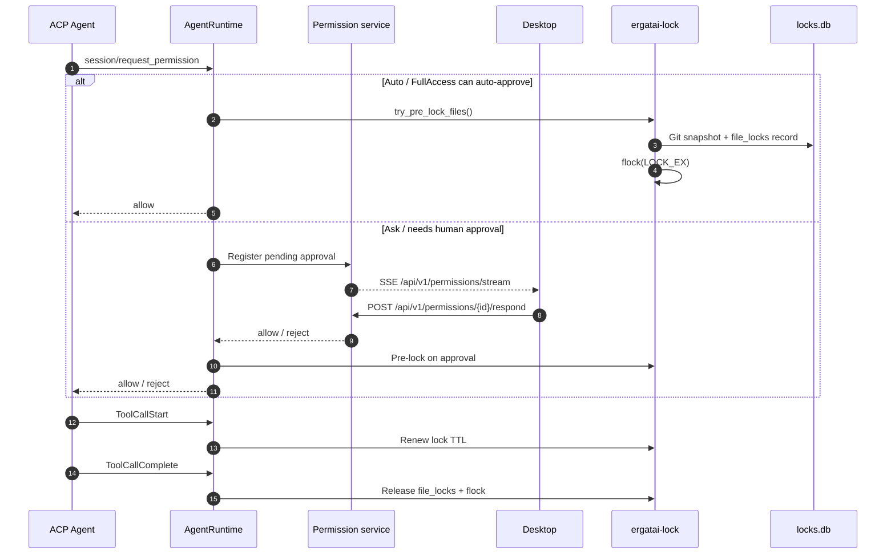

# Architecture and Data Flow

This document describes the actual runtime topology and key data flows of the current codebase, written for human readers. Working conventions and invariants for coding agents live in
[`CLAUDE.md`](../CLAUDE.md).

## 1. Process Model

| Process | Started by | Responsibilities |
|---|---|---|
| `ergatai-server` (`crates/ergatai-api`, axum) | User / `ergatai-launcher` / packaged desktop main process / `scripts/dev.sh` | REST, SSE, MCP ingress; AgentRuntime; DAG scheduling; file locks; session runtime; spawns Agents and nats-server |
| Desktop app (Electron) | User / `ergatai-launcher` | React rendering layer + main process; main process proxies HTTP/SSE via tRPC/IPC; packaged build lazily starts the embedded `ergatai-server` when no local server is running |
| `nats-server` | `ergatai-server` | Embedded JetStream event bus; random-token auth, listens on `127.0.0.1` only |
| ACP Agent subprocesses | `ergatai-server` | One ACP process per Agent; `claude-agent-acp` / `codex-acp` / `opencode acp` bridge vendor CLIs into ACP |
| Bun collaboration runtime (optional) | `ergatai-server` | Enabled via `--collab-runtime-program`; maintains collaboration state machine over stdin/stdout JSON Lines |
| SQLite / NATS storage | Various processes | Sessions, messages, locks, profiles, runtime events, and JetStream persistence |

> The desktop app is not the parent of Agents; all Agents are started and reclaimed by `ergatai-server`. Whether the
> server and Agents keep running after the desktop closes depends on how they were started: `ergatai-launcher` stops
> the server on desktop exit; the packaged desktop reclaims a server it started itself by default
> (`ERGATAI_BACKEND_KEEP_ALIVE=1` keeps it alive); a manually started or pre-existing server is never killed by the
> desktop. Set `ERGATAI_BACKEND_AUTOSTART=0` to prevent the desktop from starting a backend and only connect to an
> existing instance.

## 2. Overview



Key points:

- The **desktop** calls REST over HTTP and receives streaming events over SSE; the Electron main process is the
  actual network client.
- **Agents are server subprocesses**, communicating over ACP (JSON-RPC over stdio), not independent network services.
- The **MCP tool surface** is provided by the server. Agents invoke `send_message`, `submit_orchestration`, etc. via
  HTTP `/mcp/{agent}`, MCP-over-ACP, or `mcp-stdio-adapter`.
- **Inter-Agent messages** and **user Prompts** both enter NATS JetStream first, then get injected into the target
  ACP session by a delivery consumer.
- **Agent output** is published to a NATS conversation subject; `ConversationRuntime` consumes it, maintains a
  replayable cache, and pushes it to the desktop over SSE.
- **File locks** are acquired up front during ACP permission approval; the lock record itself is the proof of
  permission, with no separate operation token.

## 3. Client Access

### 3.1 Desktop

```text
React renderer
  └─ tRPC over IPC (preload)
       └─ Electron main process
            ├─ HTTP  → ergatai-server /api/v1/*
            └─ SSE   → ergatai-server /api/v1/.../stream
```

- API base URL: `ERGATAI_API_URL`, default `http://127.0.0.1:3000`.
- Auth: server and desktop share the `.api-token` under the user data directory; whichever starts first generates it
  if missing. The desktop reads it and sends `Authorization: Bearer <token>`; it can also be set explicitly via
  `--api-token` / `ERGATAI_API_TOKEN`.
- TLS: `--tls-cert` / `--tls-key` enable HTTPS.
- `scripts/dev.sh` starts backend and frontend together and injects `ERGATAI_API_URL`.

### 3.2 HTTP / SSE / MCP

| Interface | Endpoint | Description |
|---|---|---|
| REST | `/api/v1/*` | Workspaces, Agents, conversations, locks, activity, terminals, collaboration sessions |
| MCP | `/mcp/{agent}` | Streamable HTTP, JSON-RPC 2025-06-18; a separate path per Agent |
| SSE | `/api/v1/conversations/{id}/runtime/stream` | Conversation runtime events and incremental output |
| SSE | `/api/v1/agents/{id}/events` | Agent lifecycle / activity events |
| SSE | `/api/v1/agents/{id}/stream` | Agent output stream |
| SSE | `/api/v1/permissions/stream` | Unified permission approval stream |
| SSE | `/api/v1/activity/stream` | Global activity stream |
| SSE | `/api/v1/collaboration-sessions/{id}/stream` | Collaboration session events |
| SSE | `/api/v1/terminal-sessions/{id}/stream` | Terminal output stream |
| Metrics | `/metrics` | Prometheus format |

## 4. Agent Launch and Session Recovery



Notes:

- The ACP session id is persisted in `.ergatai/sessions.db`; on restart, `session/load` is tried first, falling
  back to `session/new` on failure.
- Agent id is a Snowflake id; suspended/resumed and cross-restart recovery reuse the same `agent_id`.
- After launch, AgentRuntime scans and registers live Agents every 30 seconds; an Agent unhealthy twice in a row is
  removed.
- Agents idle for 10 minutes are auto-suspended by activity monitoring so the session can be reused on next resume.
- Profiles and managed adapters are managed via `profile_registry.db`; `claude-agent-acp` and `codex-acp` are
  installed by the adapter manager, and auto-update requires explicit opt-in
  (`ERGATAI_ADAPTERS_AUTO_UPDATE=1`).

### 4.1 MCP Tool Injection Order

After ACP `initialize` returns the Agent's MCP capabilities, selection proceeds in this order:

1. Agent supports HTTP MCP → declare `http://.../mcp/{agent}` (with Bearer token when an API token is configured).
2. Only MCP-over-ACP supported → mount `AcpMcpBridge` on the ACP connection.
3. Neither → start `mcp-stdio-adapter --url .../mcp/{agent}` and forward over stdio.

## 5. User Prompt and Output Stream



Notes:

- `AGENT_MESSAGES` is JetStream (WorkQueue, 24h TTL); `ergatai.conversation.message.*` is core NATS
  publish/subscribe for low-latency event projection and is not a persistence source.
- `ConversationRuntime` keeps an in-memory snapshot and `conversation_runtime_events.db`, supporting replay by
  `after_sequence` after a reconnect.
- Full turn output is persisted to SQLite by the accumulator; the frontend can query historical output per
  conversation.

## 6. Inter-Agent Messages



Notes:

- **Admission gate order**: self-message → per-Agent rate limit (60/min) → conversation loop guard → MeshPolicy ACL
  → Agent health check.
- **Direct fallback**: when NATS publish fails, `MessageSender` calls `AgentRuntime.inject_message()` directly and
  persists the message after successful delivery.
- **Request tracking**: `request`-type messages generate a `correlation_id`, tracked by `reqwatch`, which publishes
  `ergatai.agent.request_timeout.{agent_id}` on timeout; default timeout is 5 minutes.
- **Dedup**: the delivery consumer keeps a 5-minute processed cache; JetStream redelivery does not cause duplicate
  injection.
- **Read receipts**: requests with `requires_receipt` publish `ergatai.agent.receipt.{agent_id}`.

## 7. Permission Approval and File Locks



Notes:

- Locks are acquired **during the ACP permission approval phase**, covering Edit / Delete / Move; Bash first does
  static path extraction, falling back to post-hoc file watching when extraction fails.
- A Git COW snapshot is created before every write, for TOCTOU protection and rollback.
- `SystemToken` is the session-level admission credential; the Watchdog reclaims expired locks via heartbeat;
  the `file_locks` record is proof of permission for a specific file.
- `flock(LOCK_EX)` is an advisory kernel lock that only constrains cooperating processes that also call `flock`;
  raw Bash is not blocked by it, and is covered by snapshots and the watcher.
- Approval waits time out after 5 minutes; timeout is treated as rejection.

## 8. DAG Orchestration

```mermaid
sequenceDiagram
    autonumber
    participant A as Coordinator Agent
    participant MCP as MCP tools
    participant DAG as DagScheduler
    participant JS as NATS JetStream
    participant TS as TaskScheduler
    participant RT as AgentRuntime
    participant MON as Result monitor

    A->>MCP: submit_orchestration(YAML)
    opt Optional dry run
        A->>MCP: validate_dag_yaml(YAML)
        MCP-->>A: { valid, task_count, agents }
    end
    MCP->>DAG: Parse + 9-rule validation
    DAG->>DAG: Create CollaborationSession + MeshPolicy
    DAG->>JS: task.submit.{agent}
    JS->>TS: pull (filter: ergatai.task.submit.*)
    TS->>RT: Start Agent (AgentLauncher)
    Note over RT,MON: Agent runs and writes result file; AgentLauncher polls for result
    MON->>JS: dag.node_complete.* / dag.node_failed.*
    JS->>DAG: pull (filter: ergatai.dag.>)
    DAG->>DAG: Update nodes, evaluate downstream, check budget/timeout
    DAG->>JS: Next batch task.submit.* / dag.complete.*
    A->>MCP: get_dag_status
    MCP-->>A: Progress, node status, MeshPolicy
```

Notes:

- Only one active DAG at a time; the `dag_id` argument to `get_dag_status` is ignored.
- The coordinator Agent cannot also be a task executor in its own DAG.
- **Node timeout**: default 900 seconds; 50% Warn, 80% Escalate, 100% Fail; only `Fail` changes node state.
- **DAG-level guards**: deadline, stall watchdog, `max_agent_calls` budget.
- **Communication policy**: `open` / `adjacent` / `star:{hub}`, enforced by `send_message`'s `MeshPolicyGate`.
- DAG state and context persist in `.ergatai/dag-state-*.json` and `.ergatai/dag-context-*.json`; task plans and
  result files live under `.ergatai/.dag-plans/`; automatically recovered after a server restart.

## 9. NATS Subjects and JetStream Streams

| Subject | Stream | Purpose |
|---|---|---|
| `ergatai.agent.message.{agent_id}` | `AGENT_MESSAGES` (WorkQueue, 24h) | User Prompts, inter-Agent messages |
| `ergatai.agent.receipt.{agent_id}` | `AGENT_MESSAGES` | Read receipts |
| `ergatai.agent.request_timeout.{agent_id}` | `AGENT_MESSAGES` | reqwatch request timeout |
| `ergatai.conversation.message.{conversation_id}` | core NATS | Runtime output / conversation message projection |
| `ergatai.task.submit.{agent}` | `DAG_EVENTS` (WorkQueue, 24h) | DAG task dispatch |
| `ergatai.dag.node_complete.{node}` | `DAG_EVENTS` | Node completion |
| `ergatai.dag.node_failed.{node}` | `DAG_EVENTS` | Node failure |
| `ergatai.dag.node_warned.{node}` | `DAG_EVENTS` | Node at 50% timeout |
| `ergatai.dag.node_escalated.{node}` | `DAG_EVENTS` | Node at 80% timeout |
| `ergatai.dag.complete.{dag_id}` | `DAG_EVENTS` | DAG completion |

Notes:

- `AGENT_MESSAGES` and `DAG_EVENTS` use file storage with WorkQueue retention; messages are acked only after
  successful consumption.
- The `FILE_ACCESS_*` / `FILE_EVENTS` streams are still defined in `ergatai-nats`, but the current single-process
  lock path calls `ergatai-lock` directly and does not depend on those streams.
- nats-server uses random-token auth; the API layer additionally uses Bearer token / TLS.

## 10. Persistence

| Store | Location | Contents |
|---|---|---|
| `user_data.db` | User data directory | Projects, workspaces, chats, conversations, messages, bindings, terminal sessions |
| `profile_registry.db` | User data directory | Agent profiles, managed adapters, model metadata |
| `conversation_runtime_events.db` | User data directory | Runtime event log (SSE replay) |
| `nats-store/` | User data directory | JetStream persistence |
| `locks.db` | `{project}/.ergatai/` | `file_locks`, snapshot records, audit, token state |
| `sessions.db` | `{project}/.ergatai/` | ACP session id (`session/load`) |
| `suspended.db` | `{project}/.ergatai/` | Suspended Agent metadata |
| `agent_bindings.db` | `{project}/.ergatai/` | MCP peer ↔ runtime agent bindings |
| DAG state / plans | `{project}/.ergatai/` | DAG recovery state, plans, and result files |

The user data directory is resolved per platform and can be overridden with `ERGATAI_USER_DATA_DIR`; when unset, the
platform standard directory is used (on Linux, `~/.local/share/ergatai`).

## 11. Defensive Controls

| Control | Behavior |
|---|---|
| Message size | Single message capped at 64 KB |
| Per-Agent rate limit | 60/min, sliding window |
| NATS backpressure | Reject when `AGENT_MESSAGES` pending ≥ 1000; cache for 5 seconds |
| Delivery retries | Up to 20 times, 1s–30s exponential backoff; 5-minute dedup |
| Request timeout | Default 5 minutes; `reqwatch` publishes timeout event |
| Permission approval | 5 minutes without response treated as rejection |
| Idle suspension | Agent auto-suspended after 10 minutes of inactivity |
| DAG node timeout | Default 900s; 50% warn, 80% escalate, 100% fail |
| DAG-level guards | Deadline, stall watchdog, `max_agent_calls` |
| Conversation loop | AutoGen-style one-question-one-answer guard + message rule constraints |
| File locks | Up-front `file_locks` + Git snapshot + `flock`; watcher as fallback |
| Process isolation | Agents are independent subprocesses; working dir/env injected per profile |

## 12. Code Index

| Topic | Location |
|---|---|
| HTTP routing and startup | `crates/ergatai-api/src/main.rs`, `crates/ergatai-api/src/lib.rs` |
| REST handlers | `crates/ergatai-api/src/api/` |
| MCP tools | `crates/ergatai-api/src/mcp/` |
| Message admission and routing | `crates/ergatai-api/src/messaging/` |
| Message delivery consumer | `crates/ergatai-api/src/mcp/message_delivery.rs` |
| Agent launch strategy | `crates/ergatai-api/src/services/agent_launch/` |
| AgentRuntime / ACP | `crates/ergatai-runtime/src/runtime.rs`, `crates/ergatai-runtime/src/backends/acp.rs` |
| Profile / adapter | `crates/ergatai-runtime/src/profile_registry.rs`, `adapter_manager.rs` |
| Permission approval | `crates/ergatai-runtime/src/permission.rs`, `permission_service.rs` |
| File locks | `crates/ergatai-lock/src/lock_manager.rs`, `snapshot.rs`, `watchdog.rs` |
| NATS / JetStream | `crates/ergatai-nats/src/` |
| DAG / collaboration | `crates/ergatai-collab/src/dag_scheduler/`, `task_scheduler.rs` |
| Session runtime / SSE | `crates/ergatai-api/src/services/conversation_runtime.rs`, `nats_output_publisher.rs` |
| Database and paths | `crates/ergatai-api/src/user_data_db.rs`, `crates/ergatai-runtime/src/dirs.rs` |
