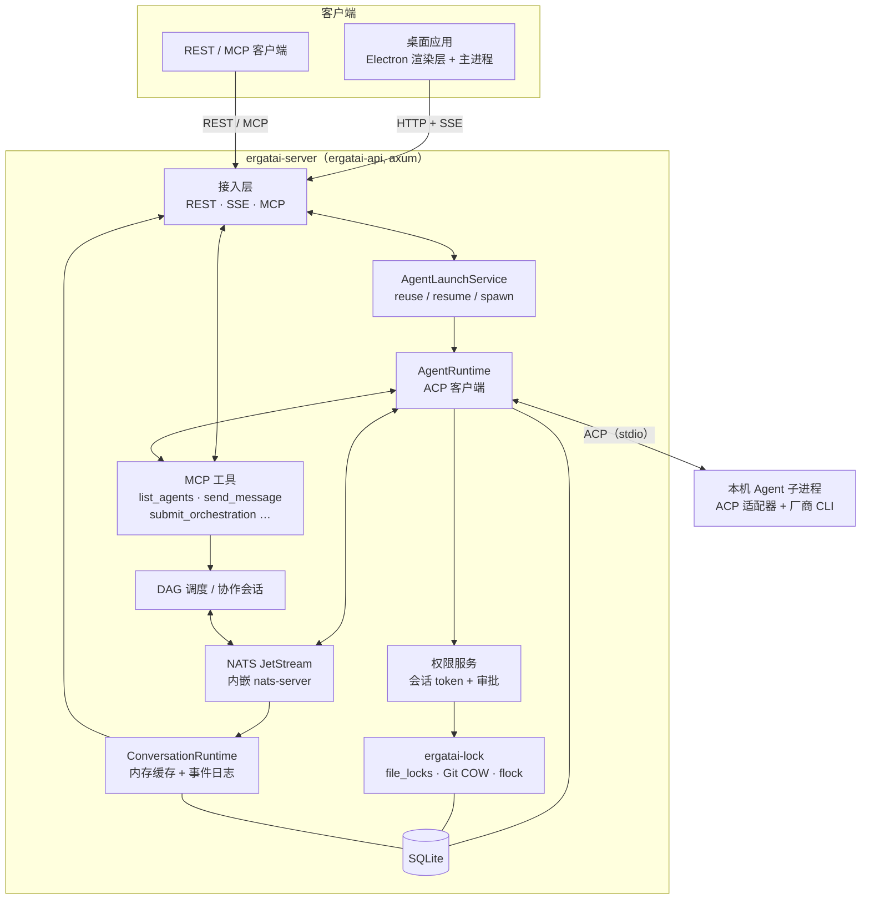
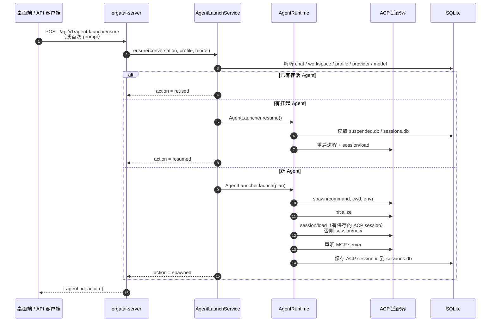
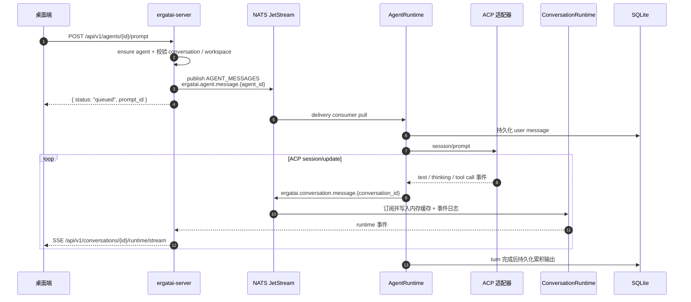
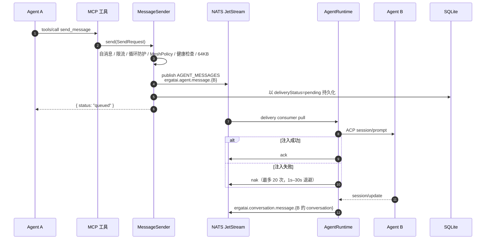
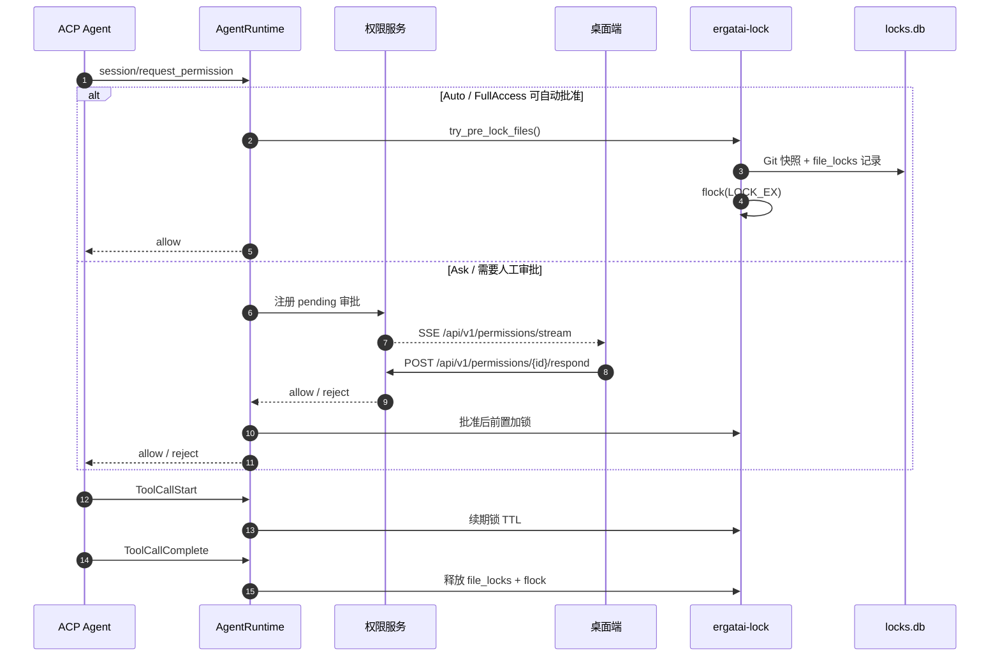
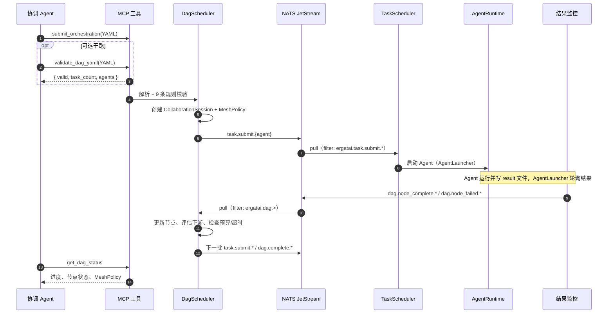

# 架构与数据流

本文描述当前代码的实际运行拓扑与关键数据流，面向人类读者。面向编码 Agent 的工作约定与不变量见
[`CLAUDE.md`](../CLAUDE.md)。

## 1. 进程模型

| 进程 | 启动方 | 职责 |
|---|---|---|
| `ergatai-server`（`crates/ergatai-api`，axum） | 用户 / `ergatai-launcher` / 打包版桌面主进程 / `scripts/dev.sh` | REST、SSE、MCP 接入；AgentRuntime；DAG 调度；文件锁；会话运行时；拉起 Agent 与 nats-server |
| 桌面应用（Electron） | 用户 / `ergatai-launcher` | React 渲染层 + 主进程；主进程通过 tRPC/IPC 代理 HTTP/SSE；打包版在本地 server 未运行时按需拉起内嵌的 `ergatai-server` |
| `nats-server` | `ergatai-server` | 内嵌 JetStream 事件总线；随机 token 认证，仅监听 `127.0.0.1` |
| ACP Agent 子进程 | `ergatai-server` | 每个 Agent 一个 ACP 进程；`claude-agent-acp` / `codex-acp` / `opencode acp` 将厂商 CLI 接入 ACP |
| Bun 协作运行时（可选） | `ergatai-server` | `--collab-runtime-program` 启用；通过 stdin/stdout JSON Lines 维护协作状态机 |
| SQLite / NATS 存储 | 各进程 | 会话、消息、锁、Profile、运行时事件与 JetStream 持久化 |

> 桌面端不是 Agent 的父进程；所有 Agent 都由 `ergatai-server` 启动和回收。桌面端关闭后，服务端与 Agent
> 是否继续运行取决于启动方式：`ergatai-launcher` 会在桌面退出时停止服务端；打包版桌面默认回收自己拉起的
> 服务端（`ERGATAI_BACKEND_KEEP_ALIVE=1` 可保留）；手动启动或已存在的服务端不会被桌面端杀掉。
> 设置 `ERGATAI_BACKEND_AUTOSTART=0` 可禁止桌面端拉起后端，只连接现成实例。

## 2. 总览



关键点：

- **桌面端**通过 HTTP 调用 REST，通过 SSE 接收流式事件；Electron 主进程是实际网络客户端。
- **Agent 是服务端子进程**，通过 ACP（JSON-RPC over stdio）通信，不是独立网络服务。
- **MCP 工具面**由服务端提供。Agent 通过 HTTP `/mcp/{agent}`、MCP-over-ACP 或 `mcp-stdio-adapter`
  调用 `send_message`、`submit_orchestration` 等工具。
- **Agent 间消息**和**用户 Prompt** 都先进入 NATS JetStream，再由投递消费者注入目标 ACP 会话。
- **Agent 输出**发布到 NATS conversation subject，`ConversationRuntime` 消费后维护可重放缓存，并通过 SSE
  推给桌面端。
- **文件锁**在 ACP 权限审批阶段前置获取；锁记录本身就是权限证明，不存在独立的操作令牌。

## 3. 客户端接入

### 3.1 桌面端

```text
React renderer
  └─ tRPC over IPC (preload)
       └─ Electron main process
            ├─ HTTP  → ergatai-server /api/v1/*
            └─ SSE   → ergatai-server /api/v1/.../stream
```

- API 地址：`ERGATAI_API_URL`，默认 `http://127.0.0.1:3000`。
- 认证：服务端与桌面端共用用户数据目录下的 `.api-token`；缺失时由先启动的一方生成。桌面端读取后以
  `Authorization: Bearer <token>` 发送；也可通过 `--api-token` / `ERGATAI_API_TOKEN` 显式配置。
- TLS：`--tls-cert` / `--tls-key` 启用 HTTPS。
- `scripts/dev.sh` 同时启动后端与前端，并注入 `ERGATAI_API_URL`。

### 3.2 HTTP / SSE / MCP

| 接口 | 端点 | 说明 |
|---|---|---|
| REST | `/api/v1/*` | 工作区、Agent、对话、锁、活动、终端、协作会话 |
| MCP | `/mcp/{agent}` | Streamable HTTP，JSON-RPC 2025-06-18；每个 Agent 独立路径 |
| SSE | `/api/v1/conversations/{id}/runtime/stream` | 对话运行时事件与增量输出 |
| SSE | `/api/v1/agents/{id}/events` | Agent 生命周期 / 活动事件 |
| SSE | `/api/v1/agents/{id}/stream` | Agent 输出流 |
| SSE | `/api/v1/permissions/stream` | 统一权限审批流 |
| SSE | `/api/v1/activity/stream` | 全局活动流 |
| SSE | `/api/v1/collaboration-sessions/{id}/stream` | 协作会话事件 |
| SSE | `/api/v1/terminal-sessions/{id}/stream` | 终端输出流 |
| Metrics | `/metrics` | Prometheus 格式 |

## 4. Agent 启动与会话恢复



要点：

- ACP session id 持久化在 `.ergatai/sessions.db`；重启后优先 `session/load`，失败再 `session/new`。
- Agent id 是 Snowflake id；挂起/恢复与跨重启恢复会复用同一个 `agent_id`。
- 启动后，AgentRuntime 每 30 秒扫描并注册存活 Agent，连续两次不健康会被移除。
- 空闲 10 分钟的 Agent 会被活动监控自动挂起，以便下次恢复时复用会话。
- Profile 与托管适配器由 `profile_registry.db` 管理；`claude-agent-acp`、`codex-acp` 由适配器管理器安装，
  自动更新需显式开启（`ERGATAI_ADAPTERS_AUTO_UPDATE=1`）。

### 4.1 MCP 工具注入顺序

ACP `initialize` 返回 Agent 的 MCP 能力后，按以下顺序选择：

1. Agent 支持 HTTP MCP → 声明 `http://.../mcp/{agent}`（配置了 API token 时带 Bearer token）。
2. 仅支持 MCP-over-ACP → 在 ACP 连接上挂载 `AcpMcpBridge`。
3. 都不支持 → 启动 `mcp-stdio-adapter --url .../mcp/{agent}`，通过 stdio 转发。

## 5. 用户 Prompt 与输出流



补充：

- `AGENT_MESSAGES` 是 JetStream（WorkQueue，24h TTL）；`ergatai.conversation.message.*` 是核心 NATS
  发布/订阅，用于低延迟事件投影，不作为持久化来源。
- `ConversationRuntime` 维护内存快照和 `conversation_runtime_events.db`，支持断线重连后按
  `after_sequence` 重放。
- 完整 turn 输出由 accumulator 持久化到 SQLite，前端可按 conversation 查询历史输出。

## 6. Agent 间消息



补充：

- **准入闸门顺序**：自消息 → 每 Agent 限流（60 条/分）→ 对话循环防护 → MeshPolicy ACL → Agent 健康检查。
- **直接回退**：NATS 发布失败时，`MessageSender` 直接调用 `AgentRuntime.inject_message()`，并在投递成功后
  持久化消息。
- **请求跟踪**：`request` 类型消息生成 `correlation_id`，由 `reqwatch` 在超时后发布
  `ergatai.agent.request_timeout.{agent_id}`；默认超时 5 分钟。
- **去重**：投递消费者维护 5 分钟已处理缓存；JetStream 重投不会造成重复注入。
- **读回执**：`requires_receipt` 的请求会发布 `ergatai.agent.receipt.{agent_id}`。

## 7. 权限审批与文件锁



要点：

- 锁在 **ACP 权限审批阶段**获取，覆盖 Edit / Delete / Move；Bash 会先做静态路径提取，提取不到则退化为
  post-hoc 文件监听。
- 每次写入前创建 Git COW 快照，用于 TOCTOU 防护与回滚。
- `SystemToken` 是会话级准入凭证，Watchdog 通过心跳回收过期锁；`file_locks` 记录是具体文件权限的证明。
- `flock(LOCK_EX)` 是内核 advisory 锁，只约束同样调用 `flock` 的协作进程；raw Bash 不受它阻塞，由快照和
  watcher 兜底。
- 审批等待超时为 5 分钟；超时按拒绝处理。

## 8. DAG 编排



要点：

- 同一时间只允许一个活跃 DAG；`dag_id` 参数在 `get_dag_status` 中会被忽略。
- 协调 Agent 不能同时作为自己 DAG 的任务执行者。
- **节点超时**：默认 900 秒，50% Warn、80% Escalate、100% Fail；`Fail` 才会改变节点状态。
- **DAG 级防线**：deadline、stall watchdog、`max_agent_calls` 预算。
- **通信策略**：`open` / `adjacent` / `star:{hub}`，由 `send_message` 的 `MeshPolicyGate` 强制执行。
- DAG 状态与上下文持久化在 `.ergatai/dag-state-*.json`、`.ergatai/dag-context-*.json`，任务计划与结果文件
  位于 `.ergatai/.dag-plans/`，服务端重启后会自动恢复。

## 9. NATS Subject 与 JetStream Stream

| Subject | Stream | 用途 |
|---|---|---|
| `ergatai.agent.message.{agent_id}` | `AGENT_MESSAGES`（WorkQueue，24h） | 用户 Prompt、Agent 间消息 |
| `ergatai.agent.receipt.{agent_id}` | `AGENT_MESSAGES` | 读回执 |
| `ergatai.agent.request_timeout.{agent_id}` | `AGENT_MESSAGES` | reqwatch 请求超时 |
| `ergatai.conversation.message.{conversation_id}` | 核心 NATS | 运行时输出 / 会话消息投影 |
| `ergatai.task.submit.{agent}` | `DAG_EVENTS`（WorkQueue，24h） | DAG 任务下发 |
| `ergatai.dag.node_complete.{node}` | `DAG_EVENTS` | 节点完成 |
| `ergatai.dag.node_failed.{node}` | `DAG_EVENTS` | 节点失败 |
| `ergatai.dag.node_warned.{node}` | `DAG_EVENTS` | 节点超时 50% |
| `ergatai.dag.node_escalated.{node}` | `DAG_EVENTS` | 节点超时 80% |
| `ergatai.dag.complete.{dag_id}` | `DAG_EVENTS` | DAG 完成 |

补充：

- `AGENT_MESSAGES` 与 `DAG_EVENTS` 使用文件存储、WorkQueue 保留策略；消费成功后才 ack。
- `FILE_ACCESS_*` / `FILE_EVENTS` stream 仍定义在 `ergatai-nats` 中，但当前单进程锁路径主要直接调用
  `ergatai-lock`，不依赖这些 stream。
- nats-server 使用随机 token 认证；API 层另有 Bearer token / TLS。

## 10. 持久化

| 存储 | 位置 | 内容 |
|---|---|---|
| `user_data.db` | 用户数据目录 | 项目、工作区、Chat、Conversation、Message、绑定、终端会话 |
| `profile_registry.db` | 用户数据目录 | Agent Profile、托管适配器、模型元数据 |
| `conversation_runtime_events.db` | 用户数据目录 | 运行时事件日志（SSE 重放） |
| `nats-store/` | 用户数据目录 | JetStream 持久化 |
| `locks.db` | `{project}/.ergatai/` | `file_locks`、快照记录、审计、token 状态 |
| `sessions.db` | `{project}/.ergatai/` | ACP session id（`session/load`） |
| `suspended.db` | `{project}/.ergatai/` | 挂起 Agent 元数据 |
| `agent_bindings.db` | `{project}/.ergatai/` | MCP peer ↔ runtime agent 绑定 |
| DAG 状态 / 计划 | `{project}/.ergatai/` | DAG 恢复状态、计划与结果文件 |

用户数据目录按平台解析，可用 `ERGATAI_USER_DATA_DIR` 覆盖；未设置时使用平台标准目录（Linux 为
`~/.local/share/ergatai`）。

## 11. 防御性控制

| 控制 | 行为 |
|---|---|
| 消息大小 | 单条消息上限 64 KB |
| 每 Agent 限流 | 60 条/分，滑动窗口 |
| NATS 背压 | `AGENT_MESSAGES` 待处理 ≥1000 时拒绝，缓存 5 秒 |
| 投递重试 | 最多 20 次，1s–30s 指数退避；5 分钟去重 |
| 请求超时 | 默认 5 分钟，`reqwatch` 发布超时事件 |
| 权限审批 | 5 分钟未响应按拒绝处理 |
| 空闲挂起 | 10 分钟无活动自动挂起 Agent |
| DAG 节点超时 | 默认 900s；50% 警告、80% 升级、100% 失败 |
| DAG 级防线 | deadline、stall watchdog、`max_agent_calls` |
| 对话循环 | AutoGen 风格一问一答守卫 + 消息规则约束 |
| 文件锁 | 前置 `file_locks` + Git 快照 + `flock`；watcher 兜底 |
| 进程隔离 | Agent 独立子进程；工作目录/环境按 Profile 注入 |

## 12. 代码索引

| 主题 | 位置 |
|---|---|
| HTTP 路由与启动 | `crates/ergatai-api/src/main.rs`、`crates/ergatai-api/src/lib.rs` |
| REST handlers | `crates/ergatai-api/src/api/` |
| MCP 工具 | `crates/ergatai-api/src/mcp/` |
| 消息准入与路由 | `crates/ergatai-api/src/messaging/` |
| 消息投递消费者 | `crates/ergatai-api/src/mcp/message_delivery.rs` |
| Agent 启动策略 | `crates/ergatai-api/src/services/agent_launch/` |
| AgentRuntime / ACP | `crates/ergatai-runtime/src/runtime.rs`、`crates/ergatai-runtime/src/backends/acp.rs` |
| Profile / 适配器 | `crates/ergatai-runtime/src/profile_registry.rs`、`adapter_manager.rs` |
| 权限审批 | `crates/ergatai-runtime/src/permission.rs`、`permission_service.rs` |
| 文件锁 | `crates/ergatai-lock/src/lock_manager.rs`、`snapshot.rs`、`watchdog.rs` |
| NATS / JetStream | `crates/ergatai-nats/src/` |
| DAG / 协作 | `crates/ergatai-collab/src/dag_scheduler/`、`task_scheduler.rs` |
| 会话运行时 / SSE | `crates/ergatai-api/src/services/conversation_runtime.rs`、`nats_output_publisher.rs` |
| 数据库与路径 | `crates/ergatai-api/src/user_data_db.rs`、`crates/ergatai-runtime/src/dirs.rs` |
